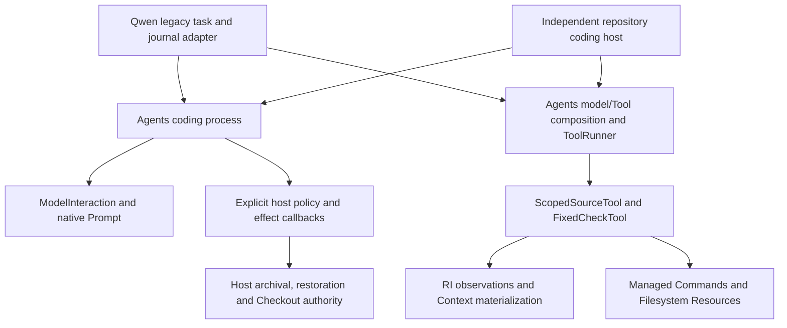

# Reusable bounded coding Agent

Migration 3 places the source/edit/check/repair sequence in
`devtools.agents.coding`, above ModelInteraction, Context and Tools. It is a
coding-specific goal process, independent of the narrow Conversation Runtime.
It does not introduce a universal Agent, Run, task language, executor or store.

## Ownership and dependency direction

`run_coding_agent(interaction, limits=..., host=...)` owns finite model/proposal
bounds, call and execution timeouts, selected response-source checking, native
batch ID admission, phase ordering, repair continuation, dispatch facts and
terminal reconciliation. The host must charge `progress.claim_action(call_id)`
before native Tool dispatch; both maintained hosts do so. An unsuccessful or
interrupted dispatch is never refunded or automatically retried. Native Prompt
still validates complete correlated input. This is not cross-invocation
deduplication or exactly-once external execution.

`CodingHost` is the one typed application seam, used by two real compositions.
It projects requests, admits proposals and supplies effects, checks, feedback
and completion custody. It does not contain another model/repair loop. The
framework does not accept a Qwen CodingTask, model profile, journal dictionary
or historical experiment layout. The host selects its interaction and settings;
provider token/template measurement remains separate from host capacity policy.

## Neutral repository profile

`RepositoryCodingHost` composes existing RI discovery/corpus/source indexing,
`SourceScope`, bounded Context range materialization, Model/Tool composition,
ToolRunner and immutable fixed checks. Its `CodingObjective` supplies an
objective, authenticated source scope, editable subset, fixed check plan and
explicit disclosure/prompt/edit bounds. There is no Python, Qwen, 32K token or
repository-layout default. Its Prompt limit is a serialized byte ceiling, not a
provider token-capacity assertion.

An optional host-selected `ProjectionPolicy` now separates retained native facts
from active input. Complete exchange selection and bounded exact-source
presentation reuse Context materialization; edit witnesses come from the
successfully prepared current Prompt. Default behavior is unchanged. See
[activation, ownership, failures and deterministic evidence](active-context-projection.md).

This concrete profile supports bounded existing UTF-8 text repairs. The model
can request `read_source`, `replace_source` and `validate_candidate`. It cannot
select an arbitrary command or acquire an unoffered Tool. Scope and currentness
are checked independently of retrieval rank. An edit requires a unique exact
anchor covered by an actually acquired current source region. Partial disclosure
does not confer access to the undisclosed remainder. The entire edit batch is
checked for authorized paths, ambiguous/overlapping anchors, operation and byte
bounds before one application dispatch. Same-file edits compose against one
source version. Host admission receives the selected native call and the entire
typed batch before effects; it may refuse any component. Model text grants no
authority.

`replace_exact_text` promotes the existing literal mechanics: exact uniqueness,
line-ending compatibility, bounded region/result, no NUL and no implicit no-op.
The host chooses whether deletion is admissible. Language/API oracles, new-file
policy and Git patch presentation are not defaults of this helper. Qwen retains
those legacy policies around the same promoted admission operation.

The required application callback applies the admitted batch once.
`write_source_changes` is a selectable convenience using existing per-file
atomic Resource writes; it is not a multi-file transaction, permission grant or
new filesystem implementation. Another trusted host may select managed Git or
another existing effect owner. Installed after-images are checked, current source
is observed again, and subsequent repair feedback contains bounded actual check
output and current source provenance. An acknowledgment failure stops the process
without replay, even when a file or Git effect is known to have occurred.

## Candidate custody and outcome facts

`SourceCustody` freezes an explicit host baseline and uses canonical decoded-text
content identities for admitted before/after versions. It performs bounded
Resource reads and refuses aliased or unknown source. Archival and restoration
effects remain required host callbacks. Restoration requires a complete known
capture, a recheck after archival and verification of the restored baseline.
Unknown installed bytes are retained for reconciliation, never erased to make
the result pass. Absence is distinct from empty content. Legacy Qwen raw SHA256
report fields are unchanged and are not replaced with this separately framed
Context content identity.

`CodingResult.candidate_validated` records the known result of required checks;
`completed` and `accepted` are distinct terminal claims. A fatal feedback,
archival or restoration failure cannot produce unconditional accepted success.
The primary exception/cancellation is retained separately from a secondary
completion error. Each dispatch retains attempted/acknowledged facts, not a
fictional rollback or proof of external entry. Unreturned usage remains `None`.
Known check results survive later reporting failure; a missing check return does
not fabricate a pass. The host may make additional acceptance requirements, as
the Qwen compatibility adapter does.

Cancellation is returned as a qualified coding result; the Qwen facade re-raises
the original error through its established outer lifecycle. Execution timeouts
bound acquisition/edit/check work, not arbitrary host cleanup. Completion
callbacks must themselves use bounded effects and respect custody. Observation
callback semantics are unchanged; no completed provider request is retried to
compensate for failed capture.

## Actual consumers and compatibility

`apps.qwen.turns.loop.run_turns` is a compatibility facade over the shared process.
Its phased adapter preserves task digests, native operation names and IDs,
prepared/native prompts, provider capacity projection, journal ordering,
readiness and source admission, fixed commands/oracles, budgets and result
projection. It has no independent model/repair loop or provider send. The outer
worker retains preflight, legacy candidate archive names, CLI schema and
publication boundaries while delegating known-source restoration mechanics to
`SourceCustody`. Controlled entry faults and boundary instrumentation protect
actual delegation, including refusal to fall back to an application loop.

The independent host in `tests/agents/coding/independent_host.py` runs the same
framework process from an authored temporary Git repository. Guards deny
application/script/experiment imports and checkout data access outside the
framework, dependencies and its independently authored test support. It requires
no Qwen prompt, configuration, task or fixture. A scripted non-Qwen interaction
requests exact source, proposes an incorrect change, receives the real failing
managed check plus current source feedback, then makes a passing corrective
edit. The literal candidate is archived and the original source restored. The
test host supplies configuration and collaborators, not a second coding loop.

Maintained controls cover missing/partial Context, required-readiness refusal,
foreign/stale source, unauthorized operations and edits, invalid and overlapping
anchors, budgets, foreign model response, native correlation, partial batches,
failed checks, cancellation, file/Git effects with lost acknowledgment, terminal
write failure and unknown installed bytes. Existing obligation-framed Qwen tests
still exercise actual Localization and active Context readiness through the
shared process; the neutral process does not mandate that application's frame.

## Limits and remaining decisions

SourceScope observations are sequential, not an atomic filesystem snapshot,
sandbox, concurrent writer lock or universal validation-input closure. The host
must serialize source mutation and own Checkout. Fixed checks attest their
declared inputs and outcomes; candidate success is not independent review,
protected validation, destination acceptance or publication authorization.

Native continuation, responses and effect notes are transient evidence, not
durable task restart or safe replay. Conversation persistence and EvidenceSink
durability are not expanded. Option B observation policy, broader A+C,
cross-process recovery and normalized Evidence ingestion remain unapproved or
separately tracked. Codex remains an external Agent integration, not a native
ModelInteraction provider. No model effectiveness or live provider portability
is claimed from deterministic tests.

The remaining application ownership includes legacy task/oracle preparation,
profile-specific capacity and prompt presentation, journals, Python/API and
new-file admission policy, repository-local Git/Checkout authority and governed
closeout. Broader B-0035/B-0043/39c6663a responsibilities remain open. A future
increment must identify a real consumer and explicit contract for any remaining
portable policy rather than promoting all application conventions by default.
