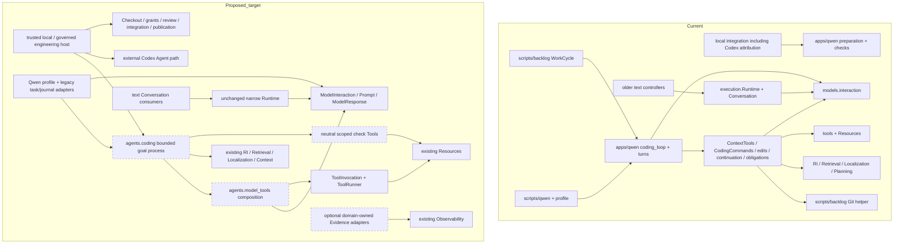

# Framework-first coding capability: architecture decision package

Status: **proposed migration design; no production migration authorized or
implemented**. The maintainer has reaffirmed reusable, model-independent
software-engineering capabilities as the current project priority. Qwen is one
consumer. That direction does not approve the proposed public APIs or change an
accepted ownership boundary by implication.

## Decision requested

Approve a reuse-first migration with a framework-owned Agent composition seam,
followed by portable repository/check mechanisms and a bounded coding-agent
consumer. Keep the current Conversation Runtime useful and narrow; do not move
the Qwen worker wholesale into it. Do not make either the Qwen application or a
new generic orchestration engine the prerequisite for using these mechanisms.

The **first implementation should promote native model/Tool composition into
the existing Agents domain and connect both the actual Qwen dispatchers and an
independent non-Qwen host**. It must exercise real Tool execution, correlated
native feedback and a fixed check. Merely moving the descriptor conversion or
adding an unused interface does not meet that increment's acceptance.

This is a small composition capability, not yet a complete reusable coding
Agent. The target for portable goal-directed coding is `devtools.agents.coding`,
subject to explicit API/policy approval in a later increment. Coordination
across Agents, branches and approval workflows remains the distinct
`devtools.orchestration` responsibility. Its current reserved namespace is not
permission to create a workflow engine now.

## Authenticated baseline and evidence

Local main, origin/main and an independent remote observation agreed at
`e84b724c18512d1659b68c0510637262506385f5`, tree
`cde38b028067437d5fa50b91197aa6c8cacd1356`. Tracked/index state was clean;
Checkout ownership was absent. The thirteen preserved forensic hashes and all
829 physical inputs of the preceding protected gate matched. The retained gate
on production `cd0a8330282d9b074ccb6d5dbf80a0f8c963c6ff` passed 3,284 tests,
two optional live skips and 100% configured production branch coverage. That gate
is historical production evidence, not newly run validation for this design.

The [source/probe companion](../research/code-audit/framework-application-direction-20261027.json)
pins selected Git blobs, physical hashes, function locations and review depths.
Fifteen current bodies were read completely; selected methods/imports and prior
exact-version audit conclusions support the other traces. Executed tests and
definition indexing do not award whole-domain review credit. This is architecture
reconciliation, not another claim that every framework/application body is audited.

Relevant authorities are [taxonomy](../architecture/taxonomy.md),
[ADR-0001](../architecture/decisions/ADR-0001-cohesive-model-interaction-boundary.md),
[ADR-0004](../architecture/decisions/ADR-0004-context-disclosure-planning-and-assembly.md),
[ADR-0005](../architecture/decisions/ADR-0005-obligation-driven-repository-localization.md),
the [roadmap](../roadmap.md), and the completed
[Qwen](../research/qwen-operational-lifecycle-audit.md),
[ModelInteraction](../research/model-interaction-and-serving-audit.md),
[Agents/Runtime](../research/agents-conversation-and-runtime-audit.md),
[Evidence](../research/evidence-usage-and-operator-audit.md), and
[Persistence](../research/persistence-and-recovery-audit.md) reviews.

## Purpose and demonstrated drift

README describes composable governed intelligence infrastructure, with a broader
long-term horizon than one engineering application. The maintainer's current
software-engineering focus is compatible with that horizon. Taxonomy makes model
identity configuration, separates Agent goals from inference and separates
orchestration from narrow Runtime. None establishes Qwen as the framework owner.

The application has become the only operational consumer and practical home of
several portable mechanisms: native call composition, source-aware acquisition,
edit admission, fixed validation, repair feedback, active-input projection and
terminal candidate accounting. Repository administration imports its private
preparation/validation helpers even for closeout attributed to Codex. This is a
real reuse/dependency problem, not simply a filename or size problem.

The prior `turns` extraction improved application cohesion and source admission;
it did **not** promote these mechanisms into a reusable framework. Its retained
behavior is useful migration evidence, not proof the application is the correct
permanent owner. Conversely, calling ModelInteraction directly is explicitly
allowed, and the application already uses substantial framework infrastructure.
The diagnosis is not that it has reimplemented every foundation.

Architecture and roadmap documents contain long chronological Qwen-first
implementation/experiment updates, including dated “Qwen remains primary” and
now-delivered pending-repair notices. Those records must retain their historical
meaning. Their placement and stale priority language must not override current
framework direction or turn experimental adoption into architectural authority.
Current planning notices now point here without rewriting experiment evidence.

## Concrete reuse and adoption matrix

“Extension” below is proposed work, not an existing API. A similar label is not
evidence that two mechanisms are interchangeable.

| Capability / actual behavior | Existing reusable owner and actual adoption | Application coupling, duplication or gap | Core sufficiency / required extension | Target responsibility and genuinely local policy |
| --- | --- | --- | --- | --- |
| Model invocation and normalized native responses | `models.interaction.ModelInteraction`, ModelRequest/Response/Settings, Prompt, native calls; `turns.loop.run_turns` calls `interaction.send` and checks selected source | Loop accepts the protocol, but imports llama.cpp classes/settings and embeds capacity branching | Invocation contract is sufficient. Do not add another provider or send wrapper merely to invoke it | ModelInteraction retains transport/normalization; Agent composition retains workflow admission; Qwen endpoint/model/sampling defaults stay local |
| Token/template capacity | `LlamaCppInteraction.count_input_tokens` reuses its real request serialization | `turns.prompt.fit_capacity` selects 32K, safety/output floors, reacquisition and `isinstance(LlamaCppInteraction)` | Base protocol does not promise token counting. Separate an optional provider measurement collaborator from caller reservation policy only when the portable consumer needs it | Provider owns measurement; caller/profile owns capacity and output policy. No Qwen constants or required llama.cpp type in portable workflow |
| Serving | `models.serving` has HF acquisition and concrete owned llama.cpp/vLLM lifecycle; uses Resources | CLI `local_interaction` checks an existing persistent service/profile and constructs an unobserved adapter; it does not start a generic Serving manager | Separate endpoint consumption and lifecycle are valid. Persistent-service and owned-container custody differ; no drop-in lifecycle substitution proven | Serving remains framework infrastructure; selected image/artifact/GPU/profile and deployment supervision remain operator/application composition |
| Conversation and one-interaction Runtime | Runtime.send retains one ConversationMessage, creates one ModelRequest, checks source and retains assistant text/ref; older two-action and patch-proposal controllers actually call it | Native worker keeps PromptMessage history and calls ModelInteraction directly | Runtime currently cannot receive the complete native request/tools; ConversationMessage has no Tool-result role/native-call fields. See alternatives below | Retain Runtime for Conversation continuity. Agent composition owns native exchanges; do not encode Tool history as opaque Conversation text |
| Native Tool disclosure/materialization/execution | ToolDescriptor, ToolInvocation, Tool, ToolRunner and ModelToolDefinition/Call exist | Pure `normalize_tool_descriptor` lives in Qwen and serves four owners. ContextTools/CodingCommands repeat model-JSON-to-typed-Tool joins | Contracts are sufficient for a narrow shared composition seam; no registry/schema framework required | Proposed `agents.model_tools` joins the domains. Tools stay model-independent; host admission remains explicit |
| Repository facts/retrieval | ContextTools uses canonical discovery, Repository/Snapshot/Resource identities, corpus, multi-granularity search, Python references and map APIs | Task-bound scope, observation receipts, native schemas and read/error presentation are app-owned; these are not a second RI parser/index | Core fact/retrieval APIs are sufficient. Operational adapters need separation from CodingTask and Qwen dictionaries | RI/Retrieval retain truth/candidates; reusable source Tools bind explicit neutral scope. Python-only/task layout and displayed instructions remain caller profiles |
| Context planning/materialization | Qwen acquire_context and ContextTools._read call existing plan/materialize APIs | `_read` materializes an identified source unit then manually bounds/serializes its range; continuation parses application receipt shapes | Planning is caller-directed, not automatic coverage/capacity. Text assembler explicitly refuses structured input. A native assembly/availability extension must reuse existing disclosure identities and Prompt | Context owns representation/current availability. Agent composition owns native feedback encoding. Do not turn Context into a mutable task/Memory store |
| Obligation readiness | `obligations.assessment` really uses Localization task/anchor/query identities, grounding, witness association, caller resolution/promotion/readiness | Frame schema, active-Prompt evidence join and action gate depend on CodingTask/ContextTools | Localization kernel exists; a reusable native availability adapter is missing. Host-authored witness judgments remain required | Localization owns satisfaction; Context availability stays distinct; trusted host owns required/helpful declarations and authority. Keep current frame JSON/hash compatibility; A+C stays unapproved |
| Exact edit admission/application | edits admits observed spans/transactions; development_task applies scoped patches through managed Commands; Checkout callback journals expected source | Portable source/version/overlap/byte checks depend on app observation dictionaries and task helpers | No existing generic file-write Tool supplies this contract. Resources.write is not a replacement for edit admission or Checkout | Promote bounded coding edit mechanics under Agents/coding and typed Tool adapters only after neutral source-observation contract. Host supplies scope/custody; no arbitrary patch/argv authority |
| Fixed checks/change currentness | CodingCommands uses ToolRunner and managed Commands; change_checks binds source/plan/Git state. Integration separately uses validate_tree | Local closeout imports `_prepare_workspace`/validate_workspace from Qwen; app check code imports backlog Git helpers | Command substrate exists; neutral frozen check/profile and scoped result contracts do not. Focused and protected/destination claims intentionally differ | Reusable check execution/admission belongs to Tools over Commands; Context/source facts retain owners. Host Git/review/publication stays separate. No framework import of scripts/backlog |
| Repair and stop policy | Native loop counts calls/proposals/actions, retains admitted source, presents failures and checks currentness | Goal-directed sequencing and outcome logic remain portable behavior in an app; task prompts/validation policies are interwoven | ModelInteraction and ToolRunner alone do not implement a coding Agent. This warrants a bounded Agent consumer, not a new universal Runtime | Proposed `agents.coding` owns model-neutral bounded goal pursuit after substrate extraction. Prompt wording, current task format and policies stay adapters |
| Active history/continuation | Framework PromptMessage preserves native calls/results; app continuation retains current observed regions/latest checks and archives full input | Compaction understands current application receipt fields and edit call names; llama.cpp is stateless and rejects ConversationRef | It is not duplicate Conversation persistence or Memory. Portable projection needs explicit typed disclosure/receipt adapters | Context representation/Agent projection split; no forced SQLite adoption or generic memory API |
| Terminal outcome/usage | ModelUsage and framework usage reconciliation exist; worker retains candidate facts, final failure and nullable category totals | v2 JSON and native stage aggregation are app-local; `sum_usage(())` returns zero while no native turns intentionally mean unknown | Reuse category arithmetic only after matching populations/identities/unknown semantics. A reusable coding outcome must not replace ModelResponse or fabricate attempts | Agent/coding owns candidate versus completion semantics; legacy v2 journal/result projection remains a compatibility adapter |
| Evidence and operator consumers | Framework inspectors and usage ledger/reporting exist; scripts/usage is a real normalized consumer | Native worker/WorkCycle/dashboard use application records, not automatic inspector ingestion | Missing producer-consumer join, not a reason for another store. Occurrence/task identity, partial capture and privacy need approval | Observability owns factual capture/normalization; host enforces mandatory evidence. Native records remain evidence sources. Option B remains unapproved |
| Persistence/restart | Conversation JSON/SQLite store semantic History/source refs; native worker does not invoke it | Native archives are not verified replay/checkpoint state; no automatic Runtime checkpoint | Existing Conversation store cannot reconstruct Tool effects, authority or unknown provider outcome. Do not serialize everything into it | Persistence stores domain-owned formats after a real recovery contract; no new backend is prerequisite for optional capture reporting |
| Governance, Checkout, review/publication | WorkCycle/Checkout/delegation/IntegrationAuthority/validate_tree/publish implement repository-local governed lifecycle | WorkCycle imports the app loop/Task; local integration imports its private checks. Author/supervisor and scope strings are Qwen/Codex policy | These are actual host workflows, not installed framework APIs. Some shared mechanics can migrate, but grants/backlog/remote semantics cannot be silently generalized | Trusted repository host retains current authority. Future orchestration may consume backend-neutral candidate/check contracts; old grants are never reinterpreted |
| Codex and other consumers | CodexAgent uses managed Commands, returns CodexConversationResult/message/ref/usage and is read-only; usage CLI consumes metadata | Local closeout accepts Qwen/Codex attribution and trusted Codex review JSON. It does not itself invoke CodexAgent as an independent reviewer | External Agent is not a native ModelInteraction. Existing import/call searches find no production Conversation-store/inspector consumer in the native path | Preserve Codex integration and independent host review. Future external coding backends need their own candidate adapter and authorization, not fake ModelResponse conformance |

The distinction between substantial existing reuse and missing integration is
central. Core Commands is already the executor; atomic Filesystem write already
exists; ToolRunner already validates/executes once. Moving app `_save` or adding a
new executor would not address the portable workflow dependency. Conversely,
directly replacing exact scoped source acquisition with the root-scoped whole-file
ReadRepositoryFileTool would lose source-unit, range, currentness and disclosure
contracts. Use that Tool where its actual contract suffices.

## Current and target dependency direction

Arrows mean caller depends on callee. Dashed target nodes are proposed.

No installed framework module may import `apps`, `scripts` or `experiments`.
Tool/model composition depends on both domains in Agents, preserving ADR-0001's
explicit prohibition of `tools -> models.interaction` and the reverse direction.
Runtime does not import Observability; optional observers retain the existing
dependency direction. Domain evidence is not governance authority.

`apps/qwen/coding_loop.py` ultimately remains a **legacy entry/result/task
adapter**, not the permanent coding-agent implementation. Its `_turns` adapter
and `model_tool_composition` facade are justified only by concrete current imports
and private maintained consumers. `scripts/qwen/coding_worker.py` remains an
operator/profile entry point. Sampling, endpoint, Qwen-serving fingerprints,
experimental task defaults and historical evaluators stay application-local.

Portable read/search/grounding/check/edit mechanisms must be invocable without
those facades. Neutral core accepts existing semantic requests, resources, scope
and Tool contracts; it must not require a Qwen CodingTask just to operate.
The current CodingTask mixes neutral data with fixed repo layout/API allowlists,
hard caps, task prompts and legacy digest omission rules. Do not blindly relocate
that class or create a second universal Task schema. Preserve its legacy encoding
at the adapter, and approve the smallest neutral inputs needed by each promoted
owner. No subclass/dataclass trick may silently change `asdict`, equality or hashes.

## Alternatives: direct reuse, extension, new shared component, local behavior

| Alternative | Concrete application | Decision / tradeoff |
| --- | --- | --- |
| A: direct reuse | ModelInteraction.send; existing native Prompt/calls; ToolInvocation/ToolRunner; Context source/materialization; managed Commands/write; existing inspectors/usage/Conversation storage within their contracts | Default. Qwen should adapt to these APIs instead of growing equivalents. Direct invocation does not require Runtime. Missing consumer wiring must not be described as a missing substrate |
| B: extend Runtime | Add a complete-request path or explicit native request builder/retention policy while retaining send compatibility | Feasible and worth comparing, but a tools-only parameter is insufficient: current Prompt rebuilding, text-only retained messages, continuation and InteractionAttempt binding all need explicit semantics. No Tool effects/goal/retry/validation policy belongs in such an extension. Not required for first migration |
| B: extend Context/check contracts | Native structured disclosure/availability, exact range views, neutral frozen check inputs | Justified by real native caller requirements. Extend existing owners, retaining old text assembler and focused/protected/destination claim separation. Do not invent new retrieval, source identity or a validation cache |
| C: narrow shared Agent composition | Proposed `agents.model_tools` joins normalized calls to explicitly selected ToolInvocation/Tool and returns the Tool-defined result | Missing reusable seam despite sufficient underlying types. A small concrete join is justified by two actual dispatchers and independent host acceptance. No new executor, registry, BaseAgent, event system or response wrapper |
| C: separate orchestration engine | A new coordinator across Agents/Runs/branches/approval suspension | Existing `orchestration` domain is a legitimate future home, but reserved code is not implementation. Current WorkCycle is repository policy. Defer generic engine until genuinely shared coordination/recovery semantics and consumers justify it; do not hide coding Agent behavior there merely to avoid Runtime |
| D: local policy | Qwen profile, prompt phrasing, exact legacy journals/tasks, sealed experiment controls; current host grants/reviewer names and publication rules | Retain. These are not framework defaults. Portable core must accept explicit host policy and preserve current policy at existing consumers; migration is not authority expansion |

### Runtime assessment, without a blanket rejection

Current Runtime is a useful stateless collaborator: one Conversation lock/input,
selected interaction, continuation lookup, source validation, output retention
and optional specialized attempt. Earlier Qwen two-action and patch controllers
prove it can participate in bounded text workflows. It is not intrinsically
incapable of future native request support.

But `send` currently constructs `Prompt(message.content, message.role.value)` and
does not supply `ModelRequest.tools`. ConversationMessage retains text/source,
not native assistant calls/reasoning/Tool-result correlation. Native llama.cpp is
stateless and rejects ConversationRef; it needs explicit complete input history.
A full Qwen-loop move into Runtime would combine these incompatible contracts
with coding/Tool/validation authority. A narrow complete-request extension would
still leave Agent policy outside Runtime and needs an explicit retention decision.

Recommendation: reuse Runtime for its existing consumers; use the already public
ModelInteraction boundary for native Agent composition. Do not add a redundant
`Runtime.invoke(request)` that only forwards `interaction.send`, and do not forge
Conversation/message IDs just to obtain InteractionAttempt records. B-0043 owns
portable goal behavior; B-0044/B-0042 own multi-boundary orchestration. Their
statuses remain unchanged by this design.

## First recommended end-to-end migration

**Scope: framework-owned native Tool composition, with actual Qwen adoption and
an application-import-free independent host.** This is the first approval request,
not permission to implement all later increments simultaneously.

1. Add a responsibility-focused leaf under existing Agents, provisionally
   `src/devtools/agents/model_tools.py`. Reuse the current descriptor projection
   body and existing model/Tool types. Do not put this bridge in `tools` or
   `models.interaction`, which would violate ADR-0001.
2. Provide one narrow selected-call composition operation: the host supplies one
   actual ModelToolCall, a ToolInvocation materializer, an already selected Tool,
   the canonical ToolRunner and explicit host admission. Materialize candidate
   typed input, admit it before effects, and invoke ToolRunner once. Return the
   Tool-defined result unchanged; propagate original failure/cancellation without
   retry or fabricated completion. Exact API/type parameters require approval.
   The operation is not an executor or grant source; host selection/admission
   and Tool semantic validation remain separate. No model-defined dispatcher map.
   Bind the call name to the **selected invocation descriptor**, not blindly to
   `Tool.name`: current ContextTools and CodingCommands multiplex native operation
   names under `qwen_repository_context` and `qwen_coding_commands`. Their concrete
   materializers can return the existing `(operation, values)` typed input. Do not
   rename native operations, add a registry or duplicate ToolRunner validation.
3. Adapt ContextTools.dispatch and CodingCommands.dispatch to this seam. Keep
   their result decoration, source/snapshot/currentness, native call ID, scope,
   byte checks and journal ordering. Use concrete operation materializers under
   existing ToolInvocation, not a universal schema interpreter. A selected
   descriptor is not a blanket grant to every executable input.
4. Keep `apps/qwen/model_tool_composition.normalize_tool_descriptor` as a direct
   compatibility facade for its four real consumers, then remove its independent
   normalization body. Current loop/history/limits and known terminal policies
   remain in place during this first change. Do not add a second mutable session.
5. Keep PromptMessage/Prompt as the correlation and complete-input types. Existing
   host batch admission must still reject missing/duplicate native IDs before
   dispatch. The shared operation must not pretend a partial batch was rolled
   back or create Tool feedback for an effect whose result is unavailable.

This is more than an interface/rename: real operational dispatch must enter the
shared code, and a second host must execute it without Qwen. Descriptor-only
promotion with unchanged app dispatch is an incomplete first increment. It also
does not finish framework Agent promotion: the following increments remove
portable source/check/workflow ownership from the application.

### Framework-independence acceptance, required before claiming promotion

Use an authored temporary repository and a minimal deterministic
`ModelInteraction` with a non-Qwen source/configuration, not a llama.cpp subclass.
Block imports of `apps`, `scripts` and `experiments`. No Qwen task names, prompts,
fixed files, hidden baseline or profile may be required. The supported library
must work independently of this checkout's application tree.

Run that acceptance host from its authored temporary working directory and
guard application file access as well as imports, or exercise the built framework
distribution without application files. An import guard alone is not proof that
code did not open a Qwen fixture/configuration by path. No repository clone,
worktree, source-tree copy, runtime installation or live call is required by this
design investigation.

The independent host must construct existing repository observations and exact
Context, send a real ModelRequest, receive a native source-read request, authorize
and execute the existing read Tool through the **promoted** composition/ToolRunner,
and retain the actual source/result under the original native ID in the next
Prompt. A later host-bound fixture edit/check Tool may mutate only the exact
expected temporary bytes using Resources and run a fixed managed Command oracle.
Its implementation is independent test-host policy, not another production
editing engine. The fixture proves native composition/effect correspondence, not
universal edit or task-recovery semantics.

Assert literal before/after bytes, exact disclosed content identities/ranges,
actual execution counts, unchanged Tool arguments, native IDs, fixed command
exit, valid strict native Prompt, provider source and nullable usage. Include
unauthorized call/name/path, stale expected source, failed check, cancellation,
foreign response, missing result after a known effect and a partial batch.
Admission failures enter no effect; uncertain entered effects run once and are
not retried. Unknown usage remains unknown. A completed Tool result does not
prove worker completion, evidence durability or publication.

The Qwen side must run existing unframed/native/obligation/CLI/repair/terminal/
Checkout/closeout controls, including all current result/digest/journal meanings.
Prove actual delegation by a shared-function entry counter or controlled fault at
that boundary, not by importing both modules. Preserve the current stage intent,
result archive, refusal/budget order and original error causality. Future source
changes require the unchanged full committed protected gate, statics and strict
mypy; this design checkpoint changes no executable inputs.

CodexAgent is a separate external Agent control. Preserve its stdin/resume,
read-only execution, continuation and result contract. Do not adapt it into the
native loop just to claim a second ModelInteraction provider. Future Codex coding
candidate execution would need an independently authorized external-agent host;
current trusted review JSON is not proof CodexAgent was invoked.

## Ordered migration increments and approval boundaries

| Priority / coherent increment | Existing to proposed owner / concrete reuse | Consumers and compatibility proof | Approval / unnecessary abstraction avoided |
| --- | --- | --- | --- |
| 1: native model/Tool composition | Qwen descriptor bridge and the materialize/admit/Runner portion of two dispatch methods to `agents.model_tools`; reuse ModelToolCall/Definition, ToolInvocation, ToolRunner and Prompt | Actual Qwen dispatchers plus independent neutral host above. Preserve v2 JSON/digests, response/source admission, exact counts, host journal order, cancellation and terminal semantics. No limits or Task wire changes | Approve the small public composition contract under B-0035/B-0043 and39c6663a. No registry, executor, BaseAgent or mandatory Runtime rewrite |
| 2: reusable source acquisition and fixed check services | Peel ContextTools observation/range/search adapters onto existing RI/Planning with Tools-facing scope; peel CodingCommands fixed bundle/plan/currentness onto Tools over Commands. Keep app native presentation and task-specific runner/oracle policies as adapters | Qwen plus actual local-closeout/Codex-attributed check consumer stop importing private Qwen validation. Independent host supplies neutral paths/snapshots/fixed Commands. Preserve exact UTF-8/CRLF, byte/range/currentness, unknown outcomes, immutable receipt allocation and focused versus protected claims | Approve neutral scope/check inputs and result semantics before moving types. Existing generic read/Command Tools are not sufficient substitutes. No generic Git abstraction, validator cache, duplicated source identity or `src -> scripts/backlog` import |
| 3: bounded model-neutral coding Agent | Portable turn/effect/check/repair/stop and candidate-versus-terminal policy from coding_loop/turns/edits into proposed `agents.coding`, using increments1–2. Keep app provider/profile/prompt/task/journal adapters; use existing Localization/readiness and Context disclosure | Qwen becomes a compatibility/profile consumer; neutral fixture completes source acquisition, admitted edit, independent checks, bounded repair and truthful terminal outcome without app imports. Existing task hashes, frames and journals stay supported by adapters | B-0043 requires explicit task/profile, action, outcome and custody contracts. No generic Run/Step/Attempt framework. Do not promote Python repo layout, oracle code, Qwen caps or prompt strings as universal defaults |
| 4: evidence/host convergence after real joins | Existing immutable journal projections into Observability/usage for one real consumer; isolate shared candidate/check inputs at WorkCycle/integration boundaries. Evaluate orchestration only for genuinely shared multi-Agent workflows | Native/operator consumer gets explicit task/occurrence/source links and unknowns. External Codex remains distinct. Existing Conversation stores remain Conversation stores; explicit host evidence admission precedes actions | B-0011/B-0023/B-0034/B-0028 and B-0044/B-0042, not implicit approval from code reuse. No EventBus, second store, automatic checkpoint/replay or workflow engine. Option B requires its separate four approvals |

For increment2, separate reusable fixed-check mechanics from the independent
protected/destination validation decision. Existing integration `validate_tree`
must still freshly validate the final destination executable inputs; source
freshness is not semantic review. Canonical Git observations should continue
using managed Commands. Initially keep repository publication/backlog Git policy
in the host rather than importing scripts from framework code or adding a new
Git abstraction just to break an import cycle.

For increment3, promotion of existing CodingTask behavior needs a compatibility
adapter rather than a universal Task redesign. Current oracle-first preflight,
Python/resource layout, exact API targets and task/digest omission defaults must
remain true for old Qwen consumers. New neutral callers can supply supported
domain inputs without those experiment defaults. Old signed grants/receipts
retain their exact original hashes and meanings; a new backend needs new host
authorization, not aliasing of a Qwen-scoped grant.

## Evidence, recovery and unresolved decisions

Provider success, capture success, Workflow admission and durable acknowledgment
remain different facts. ModelInteractionInspector and ExecutionInspector are
process-local; EvidenceSink callback success is not a durable commit certificate.
The normalized usage ledger has its own identity/conflict semantics; native no-
turn usage must not become `sum_usage(()) == 0`. Conversation persistence is not
the native Tool/source/effect checkpoint. These are missing integrations and
contracts, not permission for a new database.

The [observation decision brief](model-observation-policy-decision-brief.md)
remains recommendation only. Preferred Option B still requires per-invocation
correlation, secondary-report failure handling, privacy-safe payload/retention and
trusted-host mandatory-versus-optional evidence admission. Neither Runtime reuse
nor a framework Agent move silently approves it. No automatic retry follows an
unknown model/Tool/Git effect; preserving a response is not authority for an action.

Existing B-0035 owns Tool exposure, B-0043 Agent promotion, B-0044/B-0042
orchestration, B-0011/B-0023 evidence consumers and B-0028/B-0034 recovery. Existing
39c6663a retains cohesion pressure with a new design ADVISORY, not a duplicate
proposal or implementation approval. B-0003/B-0009 preserve their bounded
experimental history; they are not the sole authority for the reusable framework.
No record status, maturity, B-number, grant or historical approval is changed.

## Verification and stop condition

Three independent current-contract controls passed. With application/experiment
imports blocked, a non-Qwen deterministic interaction used existing native
request/response/Prompt, exact repository materialization, an actual read Tool
and one real fixed managed check; usage remained null. Runtime independently
sent a text request with zero Tool definitions, returned one unexecuted call and
retained two communication messages. Structured input to the text Context
assembler raised its documented ValueError. These are supported behavior and
extension evidence, not new bugs, migrated functionality or autonomous efficacy.

Ninety existing focused Runtime/attempt/Prompt/ToolRunner/Context tests passed,
exit0, against the authenticated baseline. No full protected gate was rerun for
documentation. Publication checks authenticate the selected blobs, all unchanged
829 production inputs, JSON/JSONL, local file links, layout, Intake chains,
whitespace, forensic hashes, original experiment/RI records and refs.

The deliverable ends at this proposed decision package. Approve increment1's
bounded contract and independence tests before implementation. Do not start a
new audit, another Qwen capability, an experiment or migration during closeout.
The next implementation is successful only when actual shared behavior can run
without Qwen and the operational Qwen consumer delegates to it; making the
application more sophisticated does not satisfy that criterion.

The 903 retained RI ledger rows and thirteen forensic files remain unchanged.
The qualified 93/93 fixture and606/606 historical-path dispositions do not close
the separate188 older-version obligations. Those obligations and unapproved A+C
remain tracked; neither authorizes a new research run or indefinitely substitutes
for the framework-independence acceptance above.

## Delivered framework migration 1 - 2026-10-27

The current explicit maintainer assignment authorized only the native model/Tool composition increment. Production `31627dcae17fa1e429fbc4c1f3d31941ef5803a7`, PR #48, accepted main `6a331e65ebb5f5c467a32eb694ca7a95056865a1` delivers a real Agents-owned operation used by both Qwen dispatchers and a non-Qwen host denied application imports and file reads. Existing ToolRunner, native model values, source/check Resources and host authority remain owners. [Contract, independent effects, validation and limits](native-model-tool-composition.md). Later source/check/coding-Agent migrations remain proposals requiring approval; this is not a whole-Agent promotion, parent closure or automatic status/maturity change. Original design/audit evidence and prior overlays retain their dates/blobs. `integration:native-model-tools:31627dca:20261027`.
