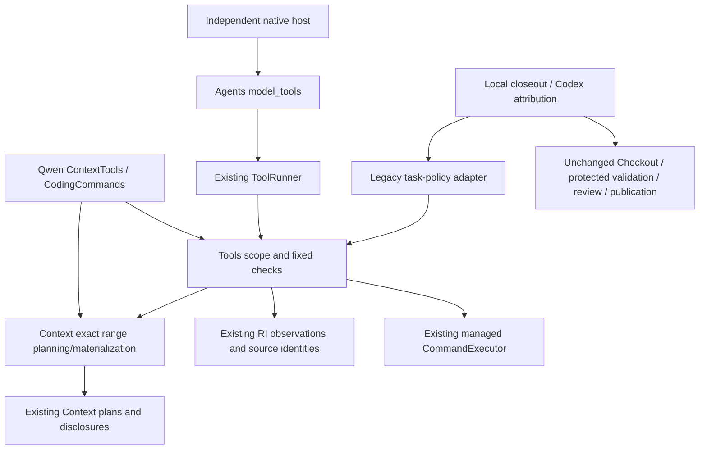

# Framework-first migration 2: scoped source acquisition and fixed validation

Delivered production `59ae70b07f7e2332db887bc61748fe5fd3373fae`, tree `bc13eb3b2fcb952a1a6bd9f79c003d6db632da3d`, through normal PR
#50. Independently verified source-integration main: `9078406b76635a81fdaf6e5b45fda2c8db6a3f4f`.
Starting main was `e9288b3de9fb5967b2d0b8723f809bda20606c6c`, tree
`e440d73e84d1e715f73b8216acaf605b52f01728`; local, origin and independent
remote observations agreed. One ordinary branch in the canonical checkout was
used. This assignment explicitly authorized only migration 2 of the retained
[framework-first direction](framework-application-direction.md).

The [machine-readable receipt](../research/code-audit/framework-source-checks-20261027.json)
retains exact original/current blobs, physical validation inputs, commands,
timestamps, durations, exits, focused test cases, literal host outcomes, baseline
controls and preservation evidence. Original audit findings remain historical;
changed versions receive maintenance overlays, not transferred audit credit.

## Delivered ownership and reuse

| Responsibility | Before | Delivered owner and actual consumers |
| --- | --- | --- |
| Exact bounded source range | ContextTools authenticated a whole unit through Context, then sliced/truncated it locally | `context.planning.source.SourceRangeDisclosureOption` and `materialize_source_range` reuse existing plans/materialization; actual ContextTools reads and independent scoped-source Tool enter this owner |
| Scoped live source admission | Task-bound alias checks around RI observations | `tools.source.SourceScope` reuses canonical Repository observations and Core path resolution; Qwen observation and an independent host use it |
| Agent-facing source operation | Application-owned typed/native read presentation | `tools.source.ScopedSourceTool` validates an explicit host scope and returns existing ContextDisclosure; Qwen retains its compatibility Tool/schema/currentness and delegates portable scope/range operations |
| Fixed bounded Command execution | Application helper constructs/executes a fixed Command | `tools.checks.FixedCheck`, `FixedCheckPlan`, `FixedCheckTool`, `FixedCheckResult` compose existing immutable Command, CommandExecutor and ToolRunner; CodingCommands and independent native host execute through them |
| Legacy test/oracle policy | Private preparation/validation in coding_loop and large development_task imports | Public `apps.qwen.validation.prepare_task_validation`/`validate_task` retain CodingTask policy and exact runner text; worker facades and local closeout delegate to that adapter; private worker/patch-reader imports disappear from local closeout |

No new index, source identity, parser, command runner, registry, validation engine,
AgentRuntime, persistence store or authorization system was created. Existing
Repository/Snapshot/ResourceOccurrence, discovery/corpus, SourceSearchIndex,
file/symbol/window representations, Context plans/disclosures, Core paths,
Resources filesystem, managed Commands, ToolRunner, ModelInteraction/Prompt and
Agents native composition remain authoritative. Tools do not import Models;
framework source imports no application, script or experiment implementation.

## Source, scope and freshness semantics

The trusted host chooses canonical root, nominal Repository, explicit addresses,
bounded observation and disclosure limits. Existing retrieval supplies candidates;
the host selects a file, symbol or window. A range is an absolute half-open
Unicode-character span within the retained parent resource. The materialized
item preserves resource/content identities, snapshot, requested and actual spans,
bounded exact text and native range provenance. UTF-8 truncation never splits
a codepoint and never claims a partial range is complete.

The live source Tool refuses foreign repository/snapshot/resource occurrences,
excessive disclosure and changed declared source. Unrelated out-of-scope files
do not invalidate the declared scope. Canonical root/cwd and entry aliases are
checked before effects. Retained Context materialization is historical source
evidence; live currentness is a separate operation. Sequential reobservation is
not an atomic filesystem snapshot, sandbox, lock or guarantee against later
external mutation. Qwen still checks currentness/edit authority separately.
Tool selection and semantic validation do not replace explicit host admission;
the native Agents composition still requires its host callback before ToolRunner.

## Fixed-check and failure semantics

A host-owned immutable tuple fixes distinct names and existing Commands: exact
argv, scoped cwd, positive timeout, environment/stdin and exit policy. The model
cannot supply replacement argv or expand the plan. Output limits remain with
the existing executor. Host loops retain explicit per-check sequencing and
earlier known results. There is no implicit batch rollback or retry.

The shared result retains the real CommandResult. Optional declared-source
rechecking yields True, or False plus the original secondary error while keeping
the completed execution. With no source scope it is None, not fabricated input
equivalence. A check passes only with successful exit, untruncated output and no
failed declared-input check. The host still owns required checks/oracles and
candidate acceptance. A focused check is neither protected validation nor review
or publication authority. Ignored configuration, transitive dependencies,
toolchain/environment and HEAD-sensitive closure are not universally attested;
the broader d58697fd obligation remains open.

Original execution exceptions and cancellation propagate; missing acknowledgment
does not prove the command never ran. No automatic repeat occurs. Known earlier
native feedback remains available. Qwen retains existing EXECUTION_INTENT when a
standalone check raises; this migration does not fabricate a terminal receipt or
implement durable replay. Protected/destination validation remains integration's
fresh-only requirement.

## Independent operational acceptance

`tests/agents/scoped_check_host.py` runs from an authored temporary Git repository
under active import and file-open guards. Its own negative guard controls refuse
`apps.qwen` and checkout application data before content access. It reads no
CodingTask, Qwen profile/prompt, application helpers or historical fixture.

A different deterministic native ModelInteraction receives an actual request,
returns a normalized `region-1` call, and consumes exact source feedback. The
host acquires the literal CRLF/Unicode source's symbol span `[12,39)`, exactly
`def answer():\r\n    return 7`, with existing content/snapshot identity. A
second native call `check-2` enters the shared fixed-check Tool and actual managed
Python command, verifies original file bytes, exits 0 and prints `checked:7\n`.
A third Prompt retains both correlated results. Unknown usage remains None.

Twelve schedules establish success; foreign resources; unsupported range; explicit
partial disclosure; stale source before read/after read; unadmitted check; exit-7
check; cancellation before Tool entry; real command effect followed by lost
acknowledgment/cancellation; and missing native feedback. Each execution occurs
at most once. The host retains earlier read feedback when a later check fails.
This is reusable acquisition/validation, not a generalized editing/coding Agent.

Actual Qwen dispatch entry/fault instrumentation proves portable range and check
delegation. A Codex-attributed real local closeout enters the same fixed-check
Tool, independently validates the installed candidate, restores source and stops
at SUPERVISORY_REVIEW without committing. It remains a legacy task/candidate
consumer, not a claim that CodexAgent is a native ModelInteraction provider.

## Compatibility and validation

The exact original runner/hash/save/timing bodies are authenticated by AST.
CodingTask, task digests, native operation names, source/result JSON, limits,
journals, obligation/readiness, edit admission/restoration, candidate-versus-run
outcomes, unknown usage and WorkCycle/Checkout/review/publication policy remain.
Moved validation implementation is included in the existing application check
plan's declared implementation inputs so relocation does not drop that input.
Historical helper imports and worker validation signatures remain thin facades.

The independently authored pre-edit source/check/local-closeout baseline passed
107 tests; the migrated baseline passed the same 107. Final focused validation:
2282 passed, 2 optional live skips. Supported Ruff,
formatting, strict mypy and layout pass. The unchanged complete protected gate
on committed production `59ae70b07f7e2332db887bc61748fe5fd3373fae` passed **3376 tests**, **2
optional live skips**, **100% configured production branch coverage**, exit 0,
in 1255.660303 command seconds. Coverage is for configured framework source, not
complete application coverage, architectural correctness or model effectiveness.
Post-main regressions pass with identical executable inputs.

Initial added consumer tests incorrectly expected a terminal FAILED receipt for
a propagated standalone exception, and raw byte preservation through Windows
Git line-ending restoration. Corrected expectations preserve the existing intent,
semantic source and clean tracked-state contract. Harness/setup/formatting issues
are retained as failed checks, not production defects. Diagnostic focused coverage
was explicitly nongating; the final protected threshold/exclusions are unchanged.
No live inference, serving startup, scientific replay or sealed evaluation ran.

## Canonical disposition and remaining decision

One append-only delivered-evidence ADVISORY reconciles existing
`39c6663a-bab7-43ed-8166-82e780a75d05`; B-0035/B-0043 receive bounded evidence
without status/maturity changes, approvals, grants, new B-numbers or parent
closure. Original audit fields and earlier overlays remain intact. All thirteen
forensic files, 903 RI rows and authored historical refs are preserved; 188
historical RI-version obligations remain separate. A+C and observation Option B
remain unapproved.

Task/oracle policy, active-Prompt projection, edit/source admission, candidate
archiving/restoration, repair/stop policy and final worker outcome remain local.
Migration 3 requires an explicit maintainer decision on a small model-neutral
coding-task/profile input, admitted edit/custody boundary, bounded repair/stop
rules, candidate-versus-terminal outcome and compatibility projections under
the existing Agents domain (proposed `devtools.agents.coding`). Reuse these
source/check Tools and native composition. Do not broaden Conversation Runtime,
promote CodingTask wholesale, move host publication authority, invent generic
Run/Result infrastructure or require a new Evidence backend. This assignment
ends after migration 2 delivery.
