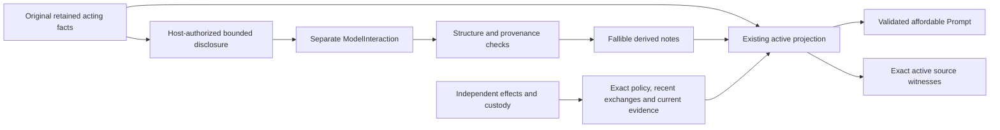

# Structured semantic working-state compaction

Implementation 2, authorized 2026-10-28, starts from
`915d3cd6d3e6029b921fd67cc1d918b9f7217a71`.

## Implementation ownership decision

This is a narrow extension of the [active projection lifecycle](active-context-projection.md).
The existing coding host still owns retained messages and active request assembly;
Context Planning still owns exact source representations; ModelInteraction owns
normalized inference; Tools/Resources and custody retain effects and authority.
No Conversation, Runtime, Evidence persistence or task serialization changes.

The cohesive `agents.coding.compaction` package owns bounded summary
configuration, structured derived notes and one optional auxiliary invocation.
It reuses `ProjectionPolicy`, `ProjectionOutcome`, complete native boundaries,
request-byte accounting and Context source materialization. The existing coding
loop remains the sole acting-model loop. A generated summary is not factual
Evidence, Repository DerivedKnowledge, a Tool result or an edit witness.

The first trigger is explicit trusted-host `request_compaction()`, not an
automatic/model-selected spend policy. Configuration alone does not invoke a
summarizer. Future adaptive triggers remain implementation 3. Host disclosure
selection and permission to replace historical messages are separate explicit
sets. Selection must respect whole native exchanges; exact task instructions,
recent exchanges, current failed-check feedback and mandatory source support
cannot be replaced. Original selected history is sent as quoted data, without
provider reasoning, and never replayed. No raw history is automatically exported.

The selected ModelInteraction has an independent finite call budget, byte bounds,
required output-token setting and timeout. Optional provider-token measurement
uses a supplied existing measurement callback and an explicit input-token ceiling;
there is no implicit tokenizer or provider default. Auxiliary usage is recorded
separately from acting-model usage, with unknown remaining unknown. Raw auxiliary
request/response retention is separately opt-in; selected active summaries follow
the host's existing Prompt retention. This is not a new Evidence capture system.

The transient version-one representation contains fallible categorized notes with
exact input-record citations and optional exact historical source-reference IDs.
It contains no authoritative completion/permission/check/acknowledgment fields.
Structural/provenance validation cannot prove the truth of arbitrary paraphrases.
Rendering labels notes as untrusted derived information, below host policy;
exact check facts and source authority remain outside the generated content.

After deterministic preparation, accepted notes may replace only explicitly
authorized complete historical blocks, with native Prompt and complete-request
capacity checked again. Current source availability is recomputed from exact
selected disclosures, never summary text. Input subset/coverage and omission are
recorded, not called complete semantic coverage. Reuse requires unchanged cited
history/source bindings; there is no recursive summary-of-summary operation.

Optional failure falls back to a valid deterministic view. Insufficient reduction
is separate from invalid output/transport failure. Caller cancellation propagates
through existing custody; no uncertain auxiliary invocation is retried. If an
observed adapter raises after provider success, the current ModelInteraction
contract may hide its response: this remains an unknown auxiliary outcome, not
permission to implement observation Option B or fabricate usage.

This decision, recorded before production edits, selects the bounded integration, not a
universal summarizer registry, memory database, workflow engine or new provider.
Deterministic tests can establish boundary behavior, not real summary fidelity.

## Host contract and operational path

There is no edge from generated notes to execution authority, source identity,
check success or custody. Failed optional compaction leaves a valid fallback.

Supply `SummaryCompaction` through `RepositoryCodingHost(summary=..., projection=...)`.
The configuration contains the selected interaction, a trusted `select(messages)`
callback returning `SummarySelection(disclose, replace)`, maximum auxiliary calls,
complete-input and output UTF-8 byte ceilings, `ModelSettings` with a finite
maximum output token count, and a `Duration` timeout. Optional token measurement
requires both a host-supplied asynchronous measurement callback and a token ceiling.
The framework does not infer provider capacity from byte limits.

`request_compaction()` schedules one attempt during the next ordinary `prepare`.
Configuration by itself spends no inference. An explicit request may summarize
affordable history to preserve progress; this increment does not choose adaptive
thresholds or expose a model-requested compaction Tool. Identical previously
entered auxiliary requests are not replayed, including after uncertain failure.
The finite call ceiling is charged at `send` entry. Acting-model calls and usage
remain in `CodingProgress`; auxiliary entry and usage remain in
`host.compaction.attempts`. Unknown usage is `None`, never inferred zero.

The selector receives original retained messages and must explicitly authorize
each outbound record. Selection does not automatically export task instructions,
source, environment or provider reasoning. Whole native exchanges are considered
in original order; a group that exceeds the complete auxiliary input budget is
excluded with partial coverage. Extra source metadata is limited to the exact
host-bound source identities of selected records. No arbitrary file is opened.
Only wholly included replacement groups can be summarized away. User/system
messages, configured recent exchanges, current failed-check feedback and source
support protected by readiness cannot be replaced.

The auxiliary request has no Tools. Its fixed instructions describe a JSON object
with `version: 1`, `notes` and `sources`. Notes have `kind`, `text`, and nonempty
`refs` containing original message indices and exact disclosed-record SHA-256
digests. Kinds cover objective, obligation, progress, decision, rejected hypothesis,
uncertainty, next step and validation. The format permits at most sixteen notes
of 2,048 characters each, further bounded by the host's output byte ceiling.
Optional source IDs must exactly match the supplied historical catalog. Duplicate
members, unsupported fields, empty/malformed notes, foreign citations, unreferenced
replacement material, foreign model source, native Tool calls and incomplete
termination are refused. A normal-stop response is required; unknown termination
cannot certify a complete summary.

This validates *structure and provenance*, not the truth, completeness or relevance
of arbitrary paraphrases. A misleading sentence can still pass these checks.
Notes are labeled untrusted derived information in an assistant message, never a
system instruction or fabricated native Tool result. Exact host instructions,
actual check evidence, current source ranges and execution/custody state remain
separate. There is no generated `accepted`, permission or acknowledgment field.

`project_request` accepts the qualified note and whole replacement indices,
reuses native `Prompt` validation, measures all request schemas/settings/messages,
and recalculates active source availability through existing Context functions.
Summary text supplies **no** source witness. A candidate projection must fit the
hard bound and reduce the original complete request. It may be larger than a
deterministic view because it preserves useful working knowledge that omission
would lose. The latest exact native exchange and current failed-check evidence
remain protected even when the derived note appears after them.

## Outcomes, failure and retention

Each requested attempt distinguishes entry, normalized response receipt,
structural validation and adoption. It records selected/replaced indices, partial
coverage, input/request/response digests, measured sizes and optional token counts,
actual available usage, and the original exception. Strategy outcomes distinguish
adoption, no eligible input, call-budget exhaustion, prior entry not replayed,
failure, cancellation and insufficient reduction. `ProjectionOutcome` remains the
owner of complete request selection, omissions and active source information.
`partial_coverage` measures coverage of retained message indices by the quoted
input records. It does not certify full semantic coverage or inclusion of excluded
provider reasoning; digests identify the exact disclosed record projection.
Here `entered` means the selected `ModelInteraction.send` was dispatched; it does
not prove a remote provider accepted or completed inference. The selected source
identity is bound before entry, including when the interaction later changes its
reported identity. Summaries with irrelevant or invented references are refused;
semantic irrelevance or hallucination despite valid citations cannot be certified
away by schema validation.

Accepted notes may be reused without another model call while their original
prefix, snapshot and replacement authorization remain valid. The current exact
window and protected evidence are rechecked. Reuse failures discard the derived
cache and preserve a valid deterministic fallback. New compactions always select
original history, never a previous summary as an authoritative source.

Timeout, transport/normalization/observation failures, invalid output and
insufficient reduction retain a valid fallback. Caller cancellation propagates
through the existing coding process and custody rather than silently continuing.
If no safe projection fits, `ProjectionCapacityError` remains explicit before
acting-model entry. Source currentness and unchanged history are checked again
after auxiliary await, including on fallback. No partially installed active
availability, effect replay, budget reset or publication permission is introduced.

Dedicated raw auxiliary request/response fields are disabled by default; hashes
and qualified stage facts remain available. Explicit `retain_payloads=True`
retains those payloads locally. This is not an erasure guarantee: retained original
exceptions can themselves contain payloads (for example, a JSON decoding error),
and an interaction may have its own capture policy. Original acting history and selected active notes still
follow the existing host retention contract. This is not durable Evidence storage,
a redaction guarantee for arbitrary model output, or a safe export policy for
exception strings. Hosts control onward retention and must handle sensitive data
appropriately before authorizing disclosure to another model.

## Independent demonstration and compatibility

The guarded non-Qwen repair fixture uses the existing `run_coding_agent`,
RepositoryCodingHost, source Tool, native Model/Tool composition, fixed checks,
managed Commands and SourceCustody in an authored temporary Git repository.
Application, script and experiment imports and canonical application file reads
are blocked. A separately identified scripted summarizer observes the actual
failed check; a subsequent acting-model request consumes the cited rejected
hypothesis plus exact failed-check/current-source feedback. The model makes the
bounded correction, the real check passes, the candidate is archived and the
original source is restored. Three acting requests and one auxiliary request are
separate, with unknown usage retained in both accounts.

Additional controls cover source-witness refusal, disjoint ranges and partial
input coverage, policy/history/source changes, unacknowledged effects, no replay,
multiple compactions, malformed/foreign output, insufficient reduction, timeout,
cancellation and an adapter hiding a response after observation failure. The
latter preserves the existing ModelInteraction contract; it does not implement
Option B.

Qwen continues to use the shared coding process and its existing application
continuation policy. This increment does not enable a competing Qwen summarizer,
alter legacy task hashes/journals, or change Tool/edit/check/custody authority.
Cases 0001–0003 remain immutable. The Case 0003 deterministic reconstruction stays
36,640 → 24,070 bytes; no semantic rescue or live continuation is claimed.

## Remaining hybrid direction

Implementation 3 remains separately authorized work: adaptive triggers and
thresholds, strategy cost/benefit selection, operator/model-requested focus, and
real continuation assessment with frozen local tasks. Provider-native opaque
compaction, durable restart, broad Evidence storage, observation Option B and
broader A+C are not delivered. Scripted tests establish boundaries and integration;
they do not measure real summarizer fidelity or improved coding effectiveness.

## Committed validation and measured evidence

Implementation `dfe62a3ed2ff353ee62e186fdaf31f4d04695bc1`, tree `44dfc06cb590a354f8bfd1d49728a9cc26c7d159`, starts from
`915d3cd6d3e6029b921fd67cc1d918b9f7217a71`. The unchanged protected command,
`uv run python scripts/validate_development.py`, ran from `2026-10-29T00:09:03.075583+00:00`
to `2026-10-29T00:32:19.698062+00:00` in 1396.398 seconds, exit 0:
**3749 passed, 2 skipped in 1394.21s (0:23:14)**. Configured production coverage is 100%,
with zero missing lines or branches. No threshold, exclusion, selector,
scientific protocol or model setting was changed.

Before implementation, 299 baseline tests passed. Broad focused validation then
passed 846 tests, including Qwen native/prepared/readiness/CLI and closeout;
144 final targeted tests cover the additional source-binding guard and semantic
capacity recovery. The final committed gate includes all maintained tests.
Committed supported Ruff and formatting pass; strict mypy passes 593 files;
layout passes. Windows Python 3.14.3, pytest 9.1.1, coverage 7.15.4, Ruff 0.16.2,
mypy 2.3.0, uv 0.12.2 and Git 2.53.0.windows.2 were observed. This is not
cross-platform or live-provider certification.

The authored projection measurement is 9,320 bytes originally, 1,268 after
deterministic omission, and 2,098 with cited notes preserving the rejected
hypothesis. The complete auxiliary input is 9,593 bytes. Its scripted known usage
is 10 input/20 output tokens, total usage unknown; it is separate from acting
usage. The guarded actual repair workflow projects 10,418 to 4,150 bytes while
keeping exact failed-check/current-source feedback. Its three acting calls and
one auxiliary call all have unknown usage; two real applications and checks
produce exits 1 then 0 with `checked:7`, then known-source restoration.
No effectiveness or token-compression claim is inferred from these fixtures.

The [machine-readable receipt](../research/code-audit/semantic-context-compaction-20261028.json)
retains exact source/test blobs, review depth, 1052 physical protected inputs,
command timings/exits, request/summary provenance, measured selections, branch
coverage and qualified failures. Full original-history hashes match. Diagnostic
subset coverage was used only to locate missing tests; the full gate is unchanged.
Initial fixture assumptions about refusal feedback/error types and one temporary
directory rejected by the file-access guard were corrected without weakening
the production contracts. A trailing-comma lint failure was corrected before
committed static checks. No failure is reclassified as a product defect.

All three frozen cases, thirteen forensic records, 903 historical RI rows and
155 historical local refs remain intact. Canonical Intake has 68 valid chains;
188 historical RI-version obligations remain. JSON/JSONL, changed-document
links, source identities and whitespace pass. Two preexisting B-0002 links to
removed root scratch reports remain qualified; no new broken links are added.
Research and Qwen assurance receive append-only changed-version overlays, with
no transfer of frozen review credit or broader backlog closure.

## Accepted-main verification

Ordinary non-force main publication accepted `37a4797099c3ff3be4c57b573a5d5d0e593b20d5`, tree `afa6622ee017f96ba5456fdc55600b9a98175aa7`,
independently verified at `2026-10-29T00:33:41.016913+00:00` through GitHub and Git remote state. It
contains implementation `dfe62a3ed2ff353ee62e186fdaf31f4d04695bc1` with the same 1052 physical
protected-validation inputs and source/test blobs. Actual repository requirements
reported push permission, no protected main rule and no additional rules/rulesets.
No PR, bypass, fabricated approval or review was used. Tracked worktree/index were
clean, existing forensic untracked files retained, and historical remote refs
preserved. This subsequent documentation-only closeout changes no executable input.
