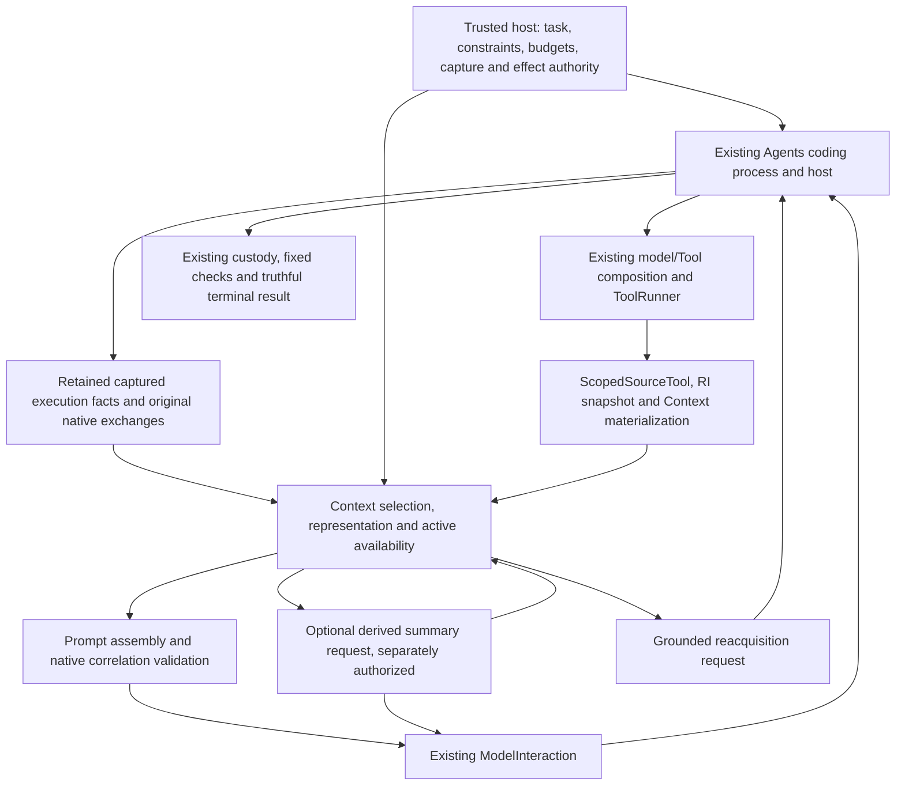

# Budget-aware agent Context: compaction research and architecture reconciliation

Review date: **October 28, 2026**. Status: **research direction approved;
implementation design pending**. Repository baseline:
`e5c332737d07e128ea03b9be859fba5bd3c2a3b5`, tree
`d89604f55ad31f201f674c4ebd13b720ea4d4cbf`.

The maintainer supports a hybrid of deterministic reduction, optional structured
summarization, recent exact exchanges and grounded reacquisition. This report
records and independently checks the supplied research topics; it does **not**
approve an API, package layout, persistent schema, summarization prompt, default
model, rollout policy or new evaluation. No implementation or inference occurred.

The recommended first increment is a shared, budget-accounted **active Context
projection** with exact native correlation and synchronized source availability.
Keep original captured facts separate. Establish deterministic safety and budget
tests before separately authorizing a summarizer or live continuation. This is
not a proposal to increase the frozen Case 0003 limit or to replace the coding
process, Context, ModelInteraction, Tools, Evidence or Persistence.

## Authority, lineage and confidence

This specializes the [October 23 harness review](agent-harness-mechanism-review.md),
not a replacement for it. That review's pinned findings remain historical. The
new pins below must not be silently substituted into its old evidence records.
Existing related research includes [purpose-relative Context](purpose-relative-repository-context.md),
[heterogeneous admission and recovery](heterogeneous-context-admission-and-recovery.md)
and [Context planning](repository-context-planning-and-graph-assisted-retrieval.md).
The [taxonomy](../architecture/taxonomy.md), accepted
[ADR-0001](../architecture/decisions/ADR-0001-cohesive-model-interaction-boundary.md),
[ADR-0002](../architecture/decisions/ADR-0002-repository-intelligence-identity-and-derivation.md),
[ADR-0003](../architecture/decisions/ADR-0003-information-need-retrieval-evidence-and-ranking.md),
[ADR-0004](../architecture/decisions/ADR-0004-context-disclosure-planning-and-assembly.md)
and [ADR-0005](../architecture/decisions/ADR-0005-obligation-driven-repository-localization.md)
retain authority. Historical ADR implementation-status paragraphs must be read
with current package contracts and delivered migrations; this report changes none.

The earlier ChatGPT review examined public documentation and selected source,
not running harnesses or independently reproducing benchmarks. Its full original
transcript was not supplied with this assignment. The supplied source list and
questions are preserved through this attributed synthesis, not represented as a
verbatim archive of an unavailable transcript. This verification independently
opened the named primary sources, inspected selected pinned implementations and
reconstructed local request accounting without running an agent.

| Label | Meaning and limit |
| --- | --- |
| **DOC** | Official documentation/vendor claim; product availability and moving pages can change. Not an independent execution result. |
| **SRC** | Direct selected upstream implementation inspection at a pinned commit; not a whole-harness audit or executed test. |
| **PAPER** | Authors' empirical results under their scaffold/task/model/protocol; preprints are not peer-reviewed consensus. |
| **LOCAL** | Frozen Devtools artifacts and actual current source, with separately stated read-only reconstruction. |
| **PROPOSAL** | Our architectural interpretation or recommendation; no promotion to authority. |
| **OPEN** | Unverified behavior, unchosen policy or missing experiment. |

[Machine source/accounting evidence](agent-context-compaction-evidence-20261028.json)
records exact local Git blobs, upstream commits/blobs/SHA-256, inspection depth,
moving documentation URLs, byte decomposition and validation. Individual upstream
files were read into an ignored inspection cache; no clone, install, upstream
execution, substantial code quotation or source copy is published. Selected
source inspection establishes mechanisms, not their effectiveness or security.

## External mechanisms

### Qwen Code: cheap reduction and a separate summary path

**SRC**, `QwenLM/qwen-code` revision
`ca204559a724a088071ea6fab025aa2efd740021`:
[microcompact.ts](https://github.com/QwenLM/qwen-code/blob/ca204559a724a088071ea6fab025aa2efd740021/packages/core/src/services/microcompaction/microcompact.ts),
[chatCompressionService.ts](https://github.com/QwenLM/qwen-code/blob/ca204559a724a088071ea6fab025aa2efd740021/packages/core/src/services/chatCompressionService.ts),
[postCompactAttachments.ts](https://github.com/QwenLM/qwen-code/blob/ca204559a724a088071ea6fab025aa2efd740021/packages/core/src/services/postCompactAttachments.ts).

Microcompaction clears eligible older Tool payloads deterministically. Eligibility
uses canonical operation identity and result shape, not arbitrary text matching.
Size pressure counts eligible output characters including pending content, but
does not clear pending results. Recent successful uncleared outputs and explicitly
preserved reads are protected; errors, empty results and previous placeholders
must not consume the protection allowance. Idle/time and size triggers differ.
The size path targets half its configured threshold to avoid repeated marginal
evictions and cache-prefix churn; protected content can prevent that target.
Media has separate handling. Evicted read paths and memory-body versions are
reported so residency can be invalidated conservatively. A cache-hit placeholder
is not proof that bytes remain visible. These are useful source-availability
lessons, not authorization to port Qwen's Tool-name allowlist.

Compression is a separate model side query. This revision computes a threshold
ladder with proportional and absolute headroom, summary-output reservation and
failure circuit breaking; constants such as 0.85 and 20,000 summary tokens are
implementation settings, not recommended Devtools defaults. The summarizer sees
curated history and pending material with input-slimming/capacity handling.
Successful output is assembled with state reminders and selected restorations;
this path does **not** simply preserve an arbitrary exact conversation suffix.
API failure, processed-empty summaries, likely truncation, invalid accounting
and inflated output have distinct failure statuses. Restoration assembly can
degrade to summary plus acknowledgment/reminders. A failed summary must not be
treated as successful history replacement. Input estimation remains fallible.
The code offers ideas for reduction, residency and failure qualification; using
this harness is not a requirement to use a Qwen model.

### Claude Code and Anthropic: clearing, summaries and exact tails

**DOC**, moving official pages, verified for this review:
[Claude Code Context window](https://code.claude.com/docs/en/context-window),
[Context editing](https://platform.claude.com/docs/en/build-with-claude/context-editing),
[compaction overview](https://platform.claude.com/docs/en/build-with-claude/compaction),
[keep recent turns](https://platform.claude.com/docs/en/build-with-claude/compaction-keep-recent-turns),
[Context engineering](https://www.anthropic.com/research/effective-context-engineering-for-ai-agents).

Claude Code documents automatic compaction near capacity and manual focused
`/compact`; thresholds depend on configuration. Instructions, source and history
all consume capacity. Its interactive illustration uses representative numbers,
not an independent capacity measurement. The engineering article describes
summarizing decisions, unresolved work and implementation details, then restoring
recent files. Its example of five recent files is historical product guidance,
not a portable policy or a guarantee of source freshness.

API Context editing clears older Tool results using a trigger, recent-pair
retention, exclusions and optional minimum savings; clearing inputs is separately
configurable. Minimum savings accounts for the cost of cache invalidation. That
is rule-based removal, not semantic summarization. The API's compaction options
include application-controlled, threshold and background variants; availability,
beta headers and thinking-block compatibility are provider-specific.

The keep-tail recipe has the host choose a cut with every Tool call/result on
the same side, summarize only the prefix and append the recent suffix unchanged.
An unresolved trailing Tool call is invalid. The host must retain the appropriate
instructions/current state when reconstructing a request. Summary, current file
reacquisition and removal of a verbose output are separate operations. The
portable lessons are boundary-safe selection and explicit reconstruction, not
mandatory Anthropic blocks, hidden state or a hosted API dependency.

### Codex and OpenAI: reconstruction versus opaque compaction

**SRC**, `openai/codex` revision
`2f47f9779282e6b273ad14bd29bec4561627083e`:
[compact.rs](https://github.com/openai/codex/blob/2f47f9779282e6b273ad14bd29bec4561627083e/codex-rs/core/src/compact.rs).
Selected code builds replacement history from retained user material and a
summary, reconstructs initial Context through session/step/world-state owners,
then installs the compacted history with provenance metadata. Reconstructing
canonical instructions and environment is a distinct responsibility from asking
a model to remember them. The inspected path has hooks, retries and error
handling; it is not evidence that every Codex configuration uses that path or
that Devtools should copy its retry semantics.

**DOC**, [OpenAI API compaction](https://developers.openai.com/api/docs/guides/compaction)
describes server-triggered and standalone compaction. Returned encrypted items
are opaque; the standalone output is a canonical replacement window, not just a
summary string to prune arbitrarily. This differs from transparent portable
summarization. [Unrolling the Codex agent loop](https://openai.com/index/unrolling-the-codex-agent-loop/)
explains initial instruction/environment assembly, cache-sensitive append-only
input and replacing history after compaction. Neither document establishes
cross-provider interpretability of encrypted state. Devtools should retain
portable facts and Context provenance even if a future optional provider adapter
supports native compaction. Codex remains an external Agent, not a required
ModelInteraction implementation or portable Context owner.

### OpenHands: retained events and a condensed view

**SRC**, `OpenHands/software-agent-sdk` revision
`47bbc5e8392c4c75b7f77a1da38bed4a9f53d6a5`:
[base.py](https://github.com/OpenHands/software-agent-sdk/blob/47bbc5e8392c4c75b7f77a1da38bed4a9f53d6a5/openhands-sdk/openhands/sdk/context/condenser/base.py),
[llm_summarizing_condenser.py](https://github.com/OpenHands/software-agent-sdk/blob/47bbc5e8392c4c75b7f77a1da38bed4a9f53d6a5/openhands-sdk/openhands/sdk/context/condenser/llm_summarizing_condenser.py).

A condenser operates on a read-only `View`; rolling condensation appends a
`Condensation` record from which a later view is derived. This separates event
history from model-visible input. The summarizing condenser can use its own LLM,
while the acting LLM supplies token-count context. Prefix/system protection and
manipulation indices keep forgetting ranges aligned with atomic boundaries.
Event count, token pressure and explicit requests have different urgency.
Soft failure can retain the original view; a hard requirement attempts bounded
reset and otherwise raises, preserving causal failure. Minimum progress prevents
accepting ineffectual reduction. Hard reset may shorten rendered inputs to fit
the summarizer, so a generated summary is not proof that all original detail was
considered. Reuse the distinction between retained facts and projected view;
do not infer Devtools has its event store or should acquire one as a prerequisite.

### Pi: appended compaction entries and recent exact history

**SRC/DOC**, specifically **earendil-works/pi**, not an assumed interchangeable
fork: revision `a87b742ff4ce262c07b7830a25c73c1442dab41b`, package
`@earendil-works/pi-coding-agent` **1.4.0**:
[compaction reference](https://github.com/earendil-works/pi/blob/a87b742ff4ce262c07b7830a25c73c1442dab41b/packages/coding-agent/docs/compaction.md),
[implementation](https://github.com/earendil-works/pi/blob/a87b742ff4ce262c07b7830a25c73c1442dab41b/packages/coding-agent/src/core/compaction/compaction.ts).

Compaction appends a summary entry with a kept-entry boundary; original entries
remain available while the request is rebuilt from summary and recent history.
Cut selection uses the current projection, not all raw entries. It protects
native Tool boundaries and handles splits within a long user-message span.
Structured progress/decision summaries and cumulative read/modified-file tracking
help continuation; path lists are not exact current-source witnesses.
Automatic pressure and explicit compaction coexist. Token estimates combine
usage anchors and estimated trailing material; rewritten projections invalidate
stale anchors. Recent exact material has a configurable budget. Summary calls
avoid cache writes for their one-off input. The documentation also describes
overflow recovery and retry ordering; that is not adopted into Devtools's
uncertain-effect policy. Retained entries support inspection, not an automatic
exactly-once replay or proof of complete durable capture.

### OpenCode: measured pressure, prepared summaries and cache timing

**SRC**, **dev** branch resolved to
`651032bc279fa61de3b8261f4b5573a7d22a6472`:
[packages/core/src/session/compaction.ts](https://github.com/anomalyco/opencode/blob/651032bc279fa61de3b8261f4b5573a7d22a6472/packages/core/src/session/compaction.ts).

The inspected current implementation combines provider-reported usage with
estimates for subsequent content, reserves capacity, and distinguishes automatic,
manual and overflow triggers. It keeps recent text beside a structured summary,
with separate provider-native replacement support. Optional background summary
preparation holds an identified prefix result until activation is needed;
installing it immediately would rewrite cache prefixes unnecessarily. Model,
anchor and tail-size checks determine whether a prepared summary remains usable.
Summary preparation tries to preserve cache-compatible input, then has bounded
fallback reductions when it cannot fit; malformed or absent summaries fail
explicitly. These are current inspected mechanisms, not the older pruning
constants described in some papers. Defaults for large hosted windows cannot
simply be applied to a 32K local deployment. Background work introduces stale
prefix, cancellation and cost-accounting questions; it is not recommended for
the first Devtools increment.

### Aider: recursive head summaries and an exact tail

**SRC**, `Aider-AI/aider` revision
`5dc9490bb35f9729ef2c95d00a19ccd30c26339c`:
[history.py](https://github.com/Aider-AI/aider/blob/5dc9490bb35f9729ef2c95d00a19ccd30c26339c/aider/history.py).

`ChatSummary` tokenizes history, keeps a recent tail near half the target and
summarizes the older head. If summary plus tail still exceeds the target it
recurses, with small-history/depth fallbacks to summarizing everything. The head
is bounded to the summarizer's input allowance. Multiple configured summary
models are tried on failure; exhausted attempts raise. Summary rendering selects
USER/ASSISTANT text and returns a user-role summary, with an assistant ending
added where necessary. That message convention does not establish native Tool
call/result preservation and cannot be pasted into Devtools Prompt. The target
is an algorithmic size goal, not a guarantee that every input fits without loss.
Its reusable lesson is head/tail budgeting and explicit failure, not its exact
message format or retry/fallback defaults.

### Pydantic AI Harness: escalation is different from error fallback

**DOC**, moving [Harness compaction](https://pydantic.dev/docs/ai/harness/compaction/):
`TieredCompaction` runs cheap-to-expensive strategies and remeasures until a
target fits. `FallbackCompaction` instead responds to selected exceptions;
cancellation/nonmatching failures propagate. Successful-but-insufficient reduction
and failed execution are different reasons to escalate. Explicit `compact_now`
and model-requested `compact_context` paths exist; host hooks admit the latter.
Pinned parts are preserved/reinjected; this does not elevate their trust level.
Compaction edits persist into run history. A receipt/run handle therefore does
not promise a pristine original transcript; earlier snapshots depend on retention.
These are useful concepts, not approval to adopt the Harness or its evolving 0.x
API, strategy names, default heuristics or history replacement contract.

[Tool output limits](https://pydantic.dev/docs/ai/harness/tool-output-limits/)
distinguishes one-time truncation, summarization and spill-to-storage with bounded
readback. A stored result is only the payload received at that boundary: native
Shell truncation already performed cannot be reversed by spilling it. Preview
limits do not necessarily include framing. Storage/retrieval failure and privacy
need their own policy; a handle is not proof of durable retention. Devtools must
record capture omissions explicitly rather than promise recovery of never-captured
bytes.

[Core message-history documentation](https://pydantic.dev/docs/ai/core-concepts/message-history/)
states that history processing replaces state history, affecting returned messages;
an original copy is needed when preservation is required. This is a concrete
mismatch with the proposed Devtools retained-original/active-view invariant.
Evaluate ideas while retaining existing native identities and ownership.

## Empirical research: what was and was not demonstrated

All results below are **PAPER**, not independently reproduced here. No external
benchmark, model, container or paid API was executed. No technique is established
as universally superior. Snapshot/source/edit authority and short local call
budgets differ materially from the published tasks.

| Study and version | Design and reported finding | Applicability and limitations |
| --- | --- | --- |
| [The Complexity Trap, v2](https://arxiv.org/html/2508.21433v2), September 5, 2025; [author repository](https://github.com/JetBrains-Research/the-complexity-trap) | Within SWE-agent/SWE-bench Verified, compares raw history, rolling observation masking and LLM summaries; Qwen3-32B thinking/nonthinking, Qwen3-Coder-480B and Gemini 2.5 Flash configurations. Masking preserves reasoning/actions while replacing old observations. Authors find comparable solve-rate/cost efficiency with less machinery, and summarization can lengthen trajectories. | Strong reason to include a cheap baseline. Primarily one scaffold, verbose coding observations and fixed heuristic schedules; preliminary OpenHands results qualify generality. Masking slows growth but does not bound indefinitely accumulating actions/reasoning. Not evidence against all hybrid policies. Repository describes workshop presentation and provides reproduction material; no local reproduction or license approval is inferred. |
| [Compact-Bench, v1](https://arxiv.org/html/2610.31710v1), submitted October 22, 2026, **preprint** | Pairs full-history and summary-only continuation from the same repository state; separately scores recurring textual details and successive production summaries. Reports 35 repairs, 146 sessions, 106 chains, and 5–64% stable damage among 22 full-history successes across tested summarizers. Best detail retention and best task continuation are not the same outcome. | Small conditional continuation population and fixed budgets; literal recurrence is not causal usefulness or understanding. Damage/rescue should be reported separately. Its limitations say private payloads/cached states are unavailable, while linked current release pages now advertise redacted histories/snapshots. Preserve that discrepancy rather than claiming complete independent reproducibility. |
| [Benchmarks Are Surprisingly Compaction-Friendly, v1](https://arxiv.org/html/2610.31778v1), submitted October 22, 2026, **preprint** | Holds OpenCode scaffold fixed, tests five strategies across three frontier models on PaperBench, ProgramBench and PostTrainBench. Threshold/method effects vary by model/task; default self-summary is not consistently beaten. Reports about one third of anticheating restrictions missing from first summaries and stronger loss of behavioral instructions than build specifications. | Fixed goals and progress recoverable from disk can conceal lost restrictions. Large hosted windows, judge-based constraint scoring and benchmark-specific variance limit transfer to local 32K coding. Passing task tests cannot certify instruction preservation. Current OpenCode source is not automatically the study's scaffold revision. |
| [AgentFold, v1](https://arxiv.org/html/2510.24699v1), October 28, 2025, **preprint version reviewed** | Trains proactive multi-scale folding for long web tasks using generated/filtered trajectories and supervised fine-tuning. Context contains state summaries plus latest interaction; folding is part of the learned response. Reports 36.2% BrowseComp and 47.3% BrowseComp-ZH for its 30B-A3B agent. | Web information seeking and a specially trained folding behavior are not ordinary local coding. Authors report prompt-only format unreliability during trajectory construction. Does not establish that an untrained local worker can safely choose what to forget, preserve permissions or maintain exact edit witnesses. No training/model adoption proposed. |
| [AgentDiet / Reducing Cost of LLM Agents with Trajectory Reduction, v2](https://arxiv.org/html/2509.23586v2), March 15, 2026; original submission September 28, 2025 | Identifies useless, redundant and expired trajectory material and uses reflection/reduction during execution, rather than replacing all history with one summary. Authors report 39.9–59.7% fewer input tokens and 21.1–35.9% lower cost with maintained task performance in their two-model/two-benchmark evaluation, implemented in Trae Agent. | Semantic reduction itself has inference overhead and fidelity risk. Agent/task generality, benchmark patch judgments and training-data leakage remain limitations. Reported price savings are not local GPU latency measurements. Preserve version identity: the unversioned URL now serves v2. |

For Compact-Bench, [code](https://github.com/cai-jianfeng/compact-bench) and the
[dataset card](https://huggingface.co/datasets/caijanfeng/compact-bench) were opened.
The card lists task histories/snapshots, session atoms, chains, checksums and
release processing. It says credential replacement is not exhaustive
anonymization and original inputs remain separately held. No dataset payload was
downloaded, release checksums verified, container built or result reproduced.
Thus **material is advertised and partly inspectable**, but private originals,
complete reproducibility and equivalence to the paper's exact runs are unverified.
The other papers' linked artifacts were not executed either. A future comparison
must freeze actual release revisions, licenses, data permissions and protocols.

## Local evidence and the exact Case 0003 failure

**LOCAL**: [Case 0001](../../experiments/local_coding_dogfood/case_0001/REPORT.md)
passed five focused and eight held-out tests with two model requests.
[Case 0002](../../experiments/local_coding_dogfood/case_0002/REPORT.md) used five
requests, investigated an 18-file repository and passed seven focused plus ten
held-out tests. Neither needed a repair turn; neither proves repair competence
or general effectiveness. Their freezes, requests and outcomes are unchanged.

[Case 0003](../../experiments/local_coding_dogfood/case_0003/REPORT.md) attempted
the existing B-0035 first-request inventory obligation on Devtools at
`721978cb9f88833a3dc3ecadc80e84aa2c6d4735`. Its
[freeze](../../experiments/local_coding_dogfood/case_0003/freeze.json),
[worker record](../../experiments/local_coding_dogfood/case_0003/evidence/worker-result.json)
and [original diagnosis](../../experiments/local_coding_dogfood/case_0003/evidence/diagnosis.json)
establish five normalized responses, six acknowledged acquisition actions and
zero proposals. Preparation of request six failed before tokenizer/provider
entry; there was no model-generated edit, failed-check feedback or repair.
The latest actual input used 9,306 provider-measured tokens, below 28,160.

The final read requested `[1,24675)` but returned only `[1,8193)`, 8,192 UTF-8
bytes, with partial=true. It was retained in correlated Tool feedback but never
sent in another inference. The earlier `repository.py` read was `[10250,11200)`,
950 bytes. These half-open character spans are **disjoint**, not overlapping.
The third source read was the characterization test `[1,6754)`, 6,754 UTF-8
bytes/6,753 characters. Inventory and search supplied metadata, not edit witnesses.

Read-only reconstruction uses the existing `ModelRequest`, native messages and
base host Tool descriptors with the original serialization expression:
`len(json.dumps(asdict(request), ensure_ascii=False).encode())`.
It yields **36,640 bytes**, exceeding **32,768 by 3,872**. It does not build or
send an alternative request. The attempted base-host check precedes the
experimental adapter's later extra Tool projection; this is not a claim about
the byte size of a sixth HTTP payload, which never existed.

| Contribution | Serialized bytes |
| --- | ---: |
| Initial objective message | 2,506 |
| Five assistant messages/calls | 1,959 |
| Listing result | 3,527 |
| Two search results | 8,182 |
| Characterization-source result | 7,818 |
| First host-source result | 1,504 |
| Final partial host-source result, never consumed | 10,085 |
| Message array delimiters/separators | 24 |
| Prompt object framing | 49 |
| Base Tool definitions | 842 |
| Settings | 58 |
| Remaining request fields/framing | 86 |
| **Total** | **36,640** |

The 10,085-byte message includes the 8,192-byte source plus identity/span fields,
message framing and nested JSON escaping. Summing raw text lengths is therefore
not complete request accounting. Listing/search message objects total 11,709
bytes, but their removable proportion and task value were not experimentally
measured. Removing overlapping source cannot explain a remedy here. The old
report's general overlap-reduction recommendation is preserved as historical
text and qualified here, not rewritten into evidence of actual overlap.

### Different capacities and ownership

| Quantity | Case 0003 meaning | Owner / caveat |
| --- | --- | --- |
| Serialized bytes | Complete base `ModelRequest` JSON under the expression above; 32,768 ceiling | Explicit `CodingObjective.prompt_bytes`, checked by `RepositoryCodingHost.prepare`; not just visible text, not wire-template tokens |
| Provider input tokens | Last measured 9,306; sixth unknown | Experimental host/provider measurement before inference; no bytes-to-tokens equivalence |
| Context window | Configured 32,768 tokens | Selected llama.cpp deployment, not a universal framework default |
| Input/output reservation | 28,160 input ceiling plus up to 4,096 output leaves 512 tokens within the profile | Frozen host envelope; no sixth capacity measurement or overflow error |
| Tool disclosure | At most 8,192 UTF-8 source bytes per read, complete/partial span explicit | Context range materialization and ScopedSourceTool; says nothing about accumulated request affordability |
| Active Prompt | Actual selected invocation messages | Material retained after request five was not necessarily model-consumed |
| Retained observation | Captured factual result with native ID and provenance | Not proof of active visibility, durable restart, understanding or authorization |

The byte check arrived with framework migration 3, commit
`22c44a88fa20da8d580b1470441030c80835b7d0`; this source body remains unchanged.
`CodingObjective` requires a positive caller-supplied limit and has no 32 KiB
default. The [coding contract](../development/bounded-coding-agent.md) explicitly
separates bytes from provider capacity. Cases 0001–0003 froze 32,768 as a
conservative experimental host setting. No inspected record establishes that
number as an empirically optimal portable operational ceiling or derives it
from a token conversion. Qwen's separate 36,000 active-byte projection and
32K token policy are different settings, not contradictory framework defaults.
Future host limits require measured overhead/reserve rationale and a new freeze;
this research neither changes nor retroactively relaxes the old limit.

No lost evidence or unauthorized source effect was observed: all six acquisitions
were acknowledged, all six archived editable files equal their baseline, custody
reported known-source restoration, and no implementation candidate was accepted.
The failure demonstrates Context usability pressure, not a broken refusal guard
or an incorrect patch. B-0035 remains open; B-0043 records related continuation
pressure. A continuation fitting after hypothetical reduction would still need
independent coding success and constraint validation.

## Current Devtools ownership and concrete reuse

The source inventory in the evidence JSON distinguishes complete small-body
inspection from targeted larger-body inspection. It is a research dependency
inspection, not additional comprehensive-audit credit for changed/old versions.

| Current owner / source | Implemented responsibility | Reuse or narrow gap |
| --- | --- | --- |
| [ModelInteraction Prompt](../../src/devtools/models/interaction/prompt.py) and [ADR-0001](../architecture/decisions/ADR-0001-cohesive-model-interaction-boundary.md) | Immutable invocation input, supported roles and complete pending native-call/result validation; provider translation belongs below it | Reuse validation after projection. It does not select history, store execution facts or implement compaction. Do not put Context policy into the provider. |
| [Coding process](../../src/devtools/agents/coding/process.py) | Bounded prepare/invoke/receive/admit/apply/check/feedback/finish sequence, source/ID checks, counters and truthful terminalization | Reuse `CodingHost.prepare` seam; do not create another loop or broaden Runtime. Summary invocation budget/failure handling needs explicit integration, not invisible calls. |
| [Repository host](../../src/devtools/agents/coding/repository.py) | Accumulates native messages, requests/responses, disclosures, checks; exact source admission and complete-input byte guard | Separate retained originals from projected messages. Currently disclosures accumulate until source refresh; a new projection must explicitly withdraw removed witnesses. This is a future integration requirement, not an existing compaction defect. |
| [Planning](../../src/devtools/context/planning/plan.py), [materialization](../../src/devtools/context/planning/materialization.py), [source ranges](../../src/devtools/context/planning/source.py) | Ordered snapshot-bound choices, content identities, exact requested/actual spans, bounded UTF-8 text and materialized provenance | Reuse; no second index, path identity, range model or source store. Existing plans record caller choices rather than optimizing capacity or summarizing history. |
| [Rendering/assembly](../../src/devtools/context/planning/rendering.py) | Faithful disclosure rendering and copied text-input ModelRequest assembly | Existing assembler explicitly rejects structured-message input. Extend the appropriate Context assembly boundary or compose it at Agents; do not pretend it already manages native history. Exact API/location remains a decision. |
| [Localization readiness](../../src/devtools/context/localization/readiness.py) | Frame identity, witness alternatives, required/helpful obligations and unresolved dispositions | Keep obligation semantics here. Representation availability is separate; summaries cannot mint witness support. |
| [Scoped source Tool](../../src/devtools/tools/source.py) | Live scope/currentness admission over retained RI/Context ranges | Reacquire through existing authorized ToolRunner and model/Tool composition; previous availability is not current read authority. |
| [Qwen continuation](../../apps/qwen/continuation.py) | Explicit metadata deduplication, stale/contained source projection, complete-exchange eviction, latest validation protection, omission/hash references, limited read reacquisition | Good deterministic characterization inputs. Its dictionary schemas, edit receipts, names and archive assumptions are application-specific. Generalize proven mechanics, not the entire parser or its defaults. |
| [Qwen turn Prompt](../../apps/qwen/turns/prompt.py) and [native obligations](../../apps/qwen/obligations/native.py) | Actual provider token measurement, phase/output reserves, selected-message projection, re-assessment of active source before admission | Retain provider/profile and legacy journal/task policy in the adapter; preserve actual projection/readiness ordering. Neutral host must not require llama.cpp methods or Qwen frame dictionaries. |
| [Evidence](../../src/devtools/observability/evidence/docs/overview.md) | Capture-controlled immutable completed-boundary facts and optional process-local inspection | Reuse provenance/availability meanings. Current ModelInteraction capture is success-only; accepted sink callback is not guaranteed durable storage or complete replay. No new Evidence store prerequisite. |
| [Custody](../../src/devtools/agents/coding/custody.py), [fixed checks](../../src/devtools/tools/checks.py), WorkCycle/Checkout | Known source, guarded restoration, check results, external authorization/review/publication | Compaction must not erase effects or change acceptance. Candidate validation, worker completion and publication remain independent. |

`apps/qwen/continuation.py` keeps native IDs and original hashes while reducing
presentation; it does not make an LLM summary. Its selection can refuse if
protected source/latest validation cannot fit. `NativeObligations.project`
assesses actual selected messages, and admission rechecks currentness. Those
invariants are useful; hardcoded phase sizes, `edit_ref`/receipt fields,
`inspect_source` wording and dynamic 32K profile policy are not neutral defaults.
The neutral coding host currently has no equivalent active-view reduction.

The taxonomy already places purpose-relative synthesis in Context. A model's
summary is interpretive derived content with provenance, **not automatically
factual Evidence or deterministic Repository DerivedKnowledge**. Evidence may
record that summarization occurred and exactly what it produced. This avoids
creating a parallel Memory system or giving generated prose execution authority.
Conversation history and its Persistence representation remain separately owned.

## Alternatives and provisional policy

| Policy | Mechanism | Benefits | Correctness, cost and failure tradeoffs |
| --- | --- | --- | --- |
| **A. Deterministic reduction only** | Shape outputs before disclosure, exact-identity deduplication, qualified masking, current-source selection, complete native exchange removal | Predictable/no inference cost; portable; easy literal tests; original capture remains intact | Cannot compress unique indispensable constraints or arbitrarily long progress. More rereads may consume time/calls. Must invalidate removed source visibility and refuse if protected material alone exceeds capacity. No measured savings asserted. |
| **B. Structured model-assisted compaction** | Protected host task/constraints plus derived progress/decisions/failed hypotheses/open obligations, recent exact exchanges and source handles | Can preserve useful intent when raw detail is large; separately selected summary model possible | Extra latency/input/output cost, omissions, instruction laundering, hallucination and summary-of-summary drift. Summary itself must fit. Empty/expanded/truncated/failed output is not success. Requires provenance, exact pins and grounded reacquisition. |
| **C. Tiered adaptive hybrid** | Prevent excessive output; use A under moderate pressure; authorize B only when necessary; preserve recent exact blocks; reacquire selected current source | Matches approved research direction; can avoid paying summary cost unnecessarily; allows phase-sensitive decisions | More policy/testing complexity. Distinguish insufficient reduction from strategy exceptions. Bound attempts/cost, avoid oscillation and cache churn, stop honestly when no permitted projection fits. No learned selector or background scheduler is required. |

**PROPOSAL:** choose C as the research trajectory, with A as the first measured
mechanism and B opt-in after independent contract tests. A is not declared
universally superior; B is not assumed safe because it emits a structured format.
Adaptive initially means deterministic policy over explicit observations, not a
new learned strategy selector. Higher-level manual/model requests may suggest
focus, but cannot delete required constraints or authorize summarizer spend.

## Proposed architecture and nonnegotiable invariants

Arrows show runtime data/composition, not permission grants or a requirement for
Context to import Agents. Context may depend on native repository/Localization
values and existing model-input values as current rendering already does;
Models and Tools remain independent, composed by Agents. Model calls are
executed by the authorized host/Agents through ModelInteraction. Context can
specify/validate a derived representation without owning provider execution.
No dependency from framework source to apps/scripts/experiments is introduced.

1. **Retain originals under explicit capture policy.** A projection cannot erase
   already-captured requests, responses, Tool facts, validation or uncertain
   effects. Capture omission/redaction/unavailability remains explicit. Retaining
   all captured originals is not a claim that all raw transport/private data was
   captured, persisted durably or can survive process restart.
2. **Active Context is a projection.** Keep its source record references,
   transformation/version, omission reasons and actual bytes separate from the
   original history. Never overwrite originals with a summary and claim recovery.
3. **Native exchanges are structurally valid.** Protect pending/unconsumed results;
   select complete call/result blocks, preserve IDs and order, and validate Prompt
   before send. Qualified masked content is not an original result. Do not invent
   calls, orphan results or dispatch a recorded call to reconstruct history.
4. **Exact availability governs edits.** Historical acquisition is not active
   source. Eviction clears its availability; a summary/hash/path alone cannot
   authorize an exact edit. Preserve snapshot/content/span identity, recheck live
   currentness, and reacquire through existing authorized reads before reliance.
   Retained immutable source can be reprojected only after applicable freshness
   checks and explicit visibility accounting.
5. **Keep mandatory instructions exact.** Reconstruct host-authored task,
   prohibitions, scope and constraints from canonical inputs. Summary prose is
   untrusted data; Tool text cannot become system policy. An instruction-looking
   source comment must not gain authority through summarization.
6. **Keep decisions distinct from facts.** A summary may describe inferred
   progress/failed hypotheses, with source references and uncertainty; it is not
   an execution receipt, permission, independent review or success certificate.
   Required obligation support remains with Localization and active availability.
7. **Do not replay effects.** Readback of retained evidence differs from invoking
   a command or Tool again. Unknown entry/acknowledgment remains unknown.
   Cancellation does not roll back prior edits/checks or successful model calls.
8. **Failures remain failures.** Insufficient space, summary failure/cancellation,
   failed capture or malformed output must not complete the engineering task.
   Preserve primary/secondary errors, candidate facts and custody obligations.
9. **Keep portable originals.** Provider-native encrypted state is optional,
   capability-qualified and not a portable source witness. Provider switching
   cannot depend on decoding another provider's opaque state.
10. **Preserve frozen science.** Old cases/settings/outcomes stay unchanged.
    Replays/projection studies are labeled read-only or new authorized follow-ups,
    never retroactively counted as the original model attempt.

### Policy, triggers and failure semantics to decide

Mechanism should measure/select/materialize/validate and return an explicit
account. Policy chooses protected units, thresholds, summaries and next action.
The host retains provider settings, privacy/cost permissions and effect authority.
No arbitrary script, model-generated scope expansion or generic policy DSL is
needed. Public signatures/module names and summary serialization are unchosen.

| Decision input | Candidate policy question |
| --- | --- |
| Phase and remaining budget | Is this discovery, edit admission, failed-check repair or completion? Is enough time/model-call budget left for a summary and useful continuation? |
| Bytes and tokens | Count complete serialized request including schemas/escaping/settings; separately measure or qualify provider tokens, output reserve and margin. Use both hard constraints; never silently convert one into the other. |
| Soft threshold / lower target | Start before a maximum Tool batch consumes the remaining room; target headroom rather than repeatedly shaving one message. Exact thresholds require local measurement. |
| Protected content | Retain canonical instructions, unresolved native correspondence, latest source-bound failed-check feedback, current obligations and selected exact source. What if these alone cannot fit? Refuse or request host decision. |
| Reuse and freshness | Which metadata is duplicated, result superseded or exact region already represented? Disjoint useful regions are not duplicates. Does current source still match? |
| Reacquisition cost | Is the evidence retained and authorized to reproject, or does it require a fresh read? Is read latency/action budget lower than summarization cost? Do not rerun validation merely to recover old output. |
| Summary authorization | Which provider/model, privacy policy, input/output/time/call budget and fallback are allowed? A model-requested compaction is advisory until admitted. |
| Failure classification | Successful but too large: try a next authorized tier. Exception: apply only a specified fallback. Cancellation: propagate and finish custody. Malformed/empty/inflated summary: preserve old view, qualify failure. |

Build a candidate projection separately and validate it before replacing the
active view. Retain the original view on failed transformation; send it only if
it still meets hard limits. Otherwise return an honest preparation failure.
Do not catch compaction errors and retry the engineering operation or hide a
previous external effect. Optional summarization has its own model outcome/usage;
it must not consume unreported extra calls or fabricate missing token counts.
Asynchronous background summaries and speculative reuse are deferred until exact
prefix identity/cancellation/cost semantics have independent evidence.

### Compatibility and unresolved approval questions

Required compatibility: existing task hashes, Qwen frame binding, Tool names and
IDs, journal originals, fixed commands, source/edit ceilings, terminal semantics,
WorkCycle/Checkout authority and unobserved provider behavior. Default absence of
the feature should preserve current behavior. Existing Qwen projection remains a
compatibility adapter until actual consumers migrate to equivalent tested shared
mechanics; do not maintain two independent implementations indefinitely.

Before implementation, approve the narrow owner/API for active projection and
availability feedback, exact protected-set semantics, complete-request accounting,
capture requirements and failure contract. Before model summaries, additionally
approve summary scope/provenance and trust level, model selection/spend/privacy,
fallbacks, output validation and preservation checks. Decide how required evidence
admission responds when an otherwise useful view cannot fit. No universal durable
schema, generic Memory, EventBus, strategy plugin registry or new provider is
justified. Observation Option B's four approval conditions, broad A+C, durable
recovery and automatic task restart remain separate.

## Evaluation and incremental delivery proposal

No evaluation below was executed in this assignment beyond read-only accounting
of retained bytes and integrity checks. Fitting a request is necessary but does
not prove valid next action, comprehension, repair competence or task success.

1. **Deterministic contracts first.** Author frozen histories with independent
   literal expected retained facts, protected instructions, native boundaries and
   current source spans. Include disjoint/overlapping/duplicate/stale reads,
   Unicode/escaped JSON, many metadata hits, pending and completed Tool batches,
   newest unconsumed result, failed checks, unknown effects, tiny capacities and
   protected-content overflow. Use retained Case 0003 as a labeled diagnostic,
   not a retuned primary attempt or hidden success oracle.
2. **Shared deterministic integration.** Compose existing Context materialization,
   native Prompt and `CodingHost.prepare`; couple selection to availability and
   readiness. Exercise actual neutral-host and Qwen adapter paths with bounded
   model doubles and independent source/edit/check assertions. No provider or app
   imports in portable mechanisms. Record originals unchanged and no duplicate
   Tool/Command execution. Treat adversarial instruction-like Tool output as data.
3. **Optional summary integration, separately approved.** Use a supplied
   ModelInteraction and bounded side request. Test empty/malformed/overlong output,
   wrong source, timeout, cancellation, missing usage, report failure and policy
   fallback independently. Compare a summary with no summary, a deterministic
   reduction and hybrid selection; do not silently reuse a summary across changed
   source/history/policy identities. Check exact restrictions outside prose scoring.
4. **Separately authorized real continuations.** Freeze task/histories, model and
   policy settings, scoring and held-out checks before inference. Use paired
   continuation from the same source state where custody permits, and separate
   trials rather than rewriting Cases 0001–0003. Count summary calls against the
   explicit evaluation budget. Include natural failed-check repair and constraints
   that are not recoverable by rereading source. Report rescue and damage
   separately, repeatability/seed limits and provider/model dependence.

| Measurement | Required account |
| --- | --- |
| Capacity | Full request bytes, known/estimated provider tokens, schemas/reserves, before/after sizes, headroom and estimator error |
| Reduction | Removed/replaced units and reasons, exact-tail size, retained-source spans, summary size; insufficient reduction distinct from failed execution |
| Cost | Summary/main model calls, available token categories, latency, reread actions and time; unknown usage stays unknown |
| Safety/correctness | Native correlation, instruction/prohibition preservation, source freshness/availability, no effect replay or authority gain |
| Continuation quality | Valid next actions, focused and held-out task results, failed-check feedback consumption, repair and exhausted-budget outcomes |
| Recoverability | Original captured hashes unchanged, readable provenance, capture gaps; no claim of durable restart without a separate storage contract |
| Portability | Non-Qwen neutral host and compatibility adapter; tokenizer/profile differences; Windows/POSIX serialization and path/Unicode cases |
| Failure policy | Cancellation, bad summary, no fitting projection, source change, partial capture, fallback count and truthful terminal status |

The single next implementation recommendation is **an opt-in deterministic
active-projection increment in existing Context/Agents composition**, including
complete-request accounting and explicit active-witness invalidation/reacquisition.
This supplies the foundation for the approved hybrid research direction without
prematurely adding summarization. Its acceptance must demonstrate useful neutral
host continuation and unchanged authority through both consumers, not just lower
byte counts. The maintainer must authorize that concrete increment; this report
does not begin it or a new model case.

## Dependencies, licensing and canonical planning

Reuse existing framework identities, `DisclosurePlan`/`ContextDisclosure`, source
Tools, Prompt validation, ModelInteraction and coding host/process. No third-party
harness dependency is recommended. GitHub metadata reports Apache-2.0 for the
reviewed Qwen Code, Codex and Aider repositories and MIT for OpenHands SDK, Pi and
OpenCode; Pi's pinned package also declares MIT. Those are metadata observations,
not a completed legal review. Verify exact files, notices, dependency licenses,
model terms and dataset rights separately before any source reuse, preserving
commercial-use flexibility. Paper access is not a code/data/model reuse license.

Canonical planning remains [B-0002](../backlog/epics/B-0002-coding-context-substrate.md)
for Context pressure, [B-0035](../backlog/items/B-0035-investigate-tool-facing-capability-exposure.md)
for bounded capability exposure and unresolved initial inventory, and
[B-0043](../backlog/items/B-0043-investigate-reusable-agent-semantics.md) for reusable
Agent continuation. Existing Evidence/recovery owners remain open. Append-only
research links change no status, dependencies, approvals, grants or parent closure.
No new B-number, accepted ADR or implementation authority is manufactured.

Documentation validation and preservation are recorded in the linked evidence
JSON. All three cases, original thirteen forensic files, 903 RI ledger rows,
historical refs and 188 outstanding historical RI-version obligations remain
unchanged. No source/app/test/configuration edit, limit increase, local/paid
inference, model-service operation, compaction implementation or full protected
gate run belongs to this documentation checkpoint.

## Subsequent implementation increment 1 — 2026-10-28

The separately authorized [active Context projection implementation](../development/active-context-projection.md)
uses the existing CodingHost preparation seam, native Prompt validation and
Context source-range materialization. It retains original available history,
projects complete exchanges, qualifies smaller source presentation and derives
edit witnesses from selected current disclosures. It is opt-in; legacy Qwen
selection shares native-boundary mechanics without adopting a second policy.

The effect-free frozen Case 0003 regression reduces the original 36,640-byte
base-host request to 24,070 bytes under the same 32,768 ceiling by omitting
completed inventory/search exchanges. All three exact source ranges survive;
the disjoint repository reads were not deduplicated. This is deterministic fit
and correlation evidence, not live continuation effectiveness or a rewritten
Case 0003 result. Original external research claims and confidence remain as
recorded above; implementation evidence does not upgrade them.

The hybrid roadmap remains explicit: increment 2 is optional, separately budgeted
provider-independent structured summarization with constraints/obligations,
progress, failed hypotheses, provenance, recent exact history and deterministic
fallback. Increment 3 evaluates adaptive thresholds, strategy timing, grounded
reacquisition and host/model/operator triggers through separately frozen
deterministic and authorized live continuations. Neither is implemented here;
no new provider, persistence system, broad A+C or observation Option B follows.
